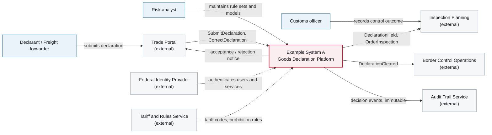

# 3. Context and Scope

<DocHeader
  structure="system-architecture"
  system="example-system-a"
  section="context-and-scope"
  generated={{
    generator: 'acme-archdoc 0.7.2',
    sourceRepo: 'git.example.com/acme-proto/example-system-a',
    revision: 'a41f7c9',
    generatedAt: '2026-08-04 03:12 UTC',
    scope: 'Whole page — system context diagram and external interface table',
  }}
/>

:::info[Fully generated page]

Derived from the system's interface descriptors. What the boundary *means* — why it sits where it
sits and what was deliberately left outside — is written by hand next to this page in
[Scope and Boundaries](/systems/example-system-a/system-architecture/context-and-scope/scope-and-boundaries/).

:::

## Business context

<Diagram
  title="System context — Example System A"
  status="generated"
  source="acme-archdoc 0.7.2 · example-system-a@a41f7c9"
  caption="External parties and neighbouring systems, with the direction of the business interaction.">

</Diagram>

## Technical interfaces

<Diagram
  title="External interfaces"
  status="generated"
  source="acme-archdoc 0.7.2 · example-system-a@a41f7c9"
  caption="Extracted from the interface descriptors in the system repository.">

| Neighbour | Direction | Transport | Contract | Notes |
| --- | --- | --- | --- | --- |
| Trade Portal | inbound | Message broker | `acme.proto.declaration.commands.v1` | Externally versioned national message specification. |
| Trade Portal | outbound | Message broker | `acme.proto.declaration.events.v1` | Acceptance, rejection and clearance notices. |
| Federal Identity Provider | inbound | HTTPS / OIDC | Discovery document | Token validation only; no user store in the system. |
| Tariff and Rules Service | outbound | HTTPS / REST | `tariff-api 3.2` | Read-only, cached for 24 h, degrades to the cache on failure. |
| Inspection Planning | outbound | Message broker | `acme.proto.inspection.commands.v1` | Inspection orders for high-risk consignments. |
| Border Control Operations | outbound | Message broker | `acme.proto.declaration.events.v1` | Clearance notifications. |
| Audit Trail Service | outbound | Message broker | `acme.proto.declaration.events.v1` | Append-only decision record, ten-year retention. |

</Diagram>

<RelatedDocs
  items={[
    {
      to: '/systems/example-system-a/system-architecture/context-and-scope/scope-and-boundaries/',
      label: 'Scope and Boundaries',
      note: 'The hand-written explanation of this diagram.',
      status: 'custom',
    },
    {
      to: '/systems/example-system-a/system-architecture/building-block-view/',
      label: '5. Building Block View',
      note: 'What is inside the box drawn above.',
      status: 'generated',
    },
    {
      to: '/systems/example-system-a/system-architecture/building-block-view/components/example-component-a/component-architecture/context-and-scope/',
      label: 'Example Component A — 3. Context and Scope',
      note: 'The same view one level down, for the intake component.',
      status: 'generated',
    },
    {
      to: '/systems/example-system-a/system-architecture/crosscutting-concerns/security-and-data-protection/',
      label: 'Security and Data Protection',
      note: 'How the external interfaces are secured.',
      status: 'custom',
    },
  ]}
/>
