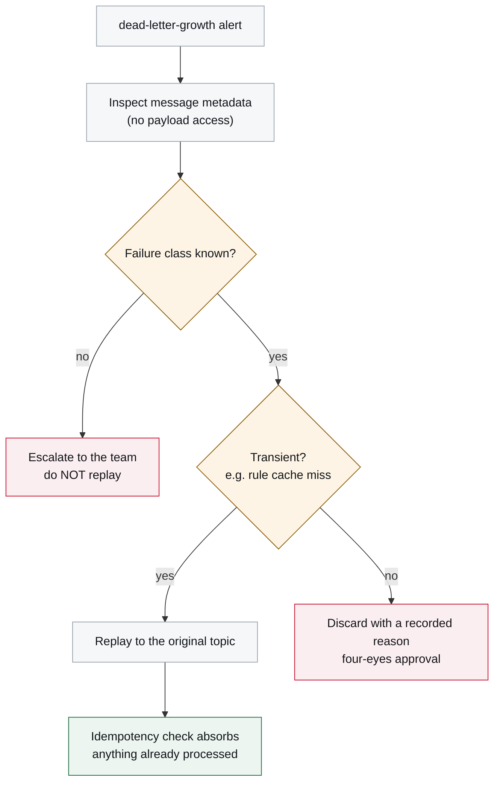
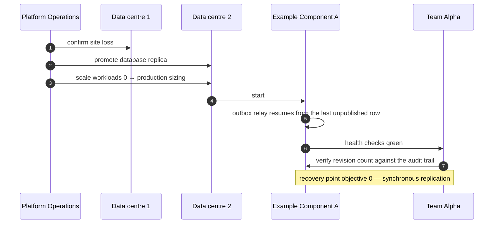

# Failover and Replay

<DocHeader
  structure="system-architecture"
  system="example-system-a"
  component="example-component-a"
  section="runtime-view"
  custom={{
    owner: 'Team Alpha — Declaration Squad with Platform Operations (fictional)',
    lastReviewed: '2026-07-19',
    reviewStatus: 'Reviewed',
  }}
/>

:::note[Custom page below a component arc42 section]
Written by hand and reviewed with operations. It sits directly after
[6. Runtime View](/systems/example-system-a/system-architecture/building-block-view/components/example-component-a/component-architecture/runtime-view/) in the
navigation because that is where a reader looks for runtime behaviour — no generator writes to
this page.

:::

## Failure modes and what happens

| Failure | Effect | Recovery |
| --- | --- | --- |
| Outbox relay stops | State changes still commit; events stop flowing. Downstream goes quiet. | Restart the relay. It republishes everything unpublished, in order. No data is lost. |
| Broker unavailable | Commands are not delivered; the outbox grows. | Nothing to do in the component. When the broker returns, the relay drains the outbox. |
| Poison message (unparseable, or a rule the domain rejects structurally) | Retried, then dead-lettered after 5 attempts. | Classify, then replay or discard — see below. |
| Database unavailable | The component is unhealthy and stops acknowledging. Nothing is accepted. | Platform issue. Intake is unavailable, which is honest: nothing is silently dropped. |
| Duplicate delivery | Idempotency check on the processed-message table discards it. | None needed. Logged at `DEBUG`. |

## Replay procedure

**The rule that matters: classify before replaying.** Replaying a message whose failure cause is
unknown either fails again or, worse, succeeds for the wrong reason. Replay is safe with respect
to duplicates — the idempotency check guarantees that — but it is not safe with respect to
incorrect input.

## Site failover

A site failover is a platform operation; this component only has to survive it.

After a failover the team verifies that the number of revisions matches the audit trail's event
count. A mismatch would mean the outbox and the state diverged, which has never happened and is
exactly why it is checked.

## What is not automated, and why

Replay is manual for the failure classes that are not yet understood — see debt item **D-3** in
[11. Risks and Technical Debt](/systems/example-system-a/system-architecture/risks-and-technical-debt/). Automating
replay before knowing the failure classes would automate the wrong decision.

<RelatedDocs
  items={[
    {
      to: '/systems/example-system-a/system-architecture/building-block-view/components/example-component-a/component-architecture/runtime-view/',
      label: '6. Runtime View',
      note: 'The parent arc42 section.',
      status: 'generated',
    },
    {
      to: '/systems/example-system-a/system-architecture/crosscutting-concerns/operations-and-monitoring/',
      label: 'Operations and Monitoring',
      note: 'The alerts that start this procedure.',
      status: 'custom',
    },
    {
      to: '/systems/example-system-a/system-architecture/building-block-view/components/example-component-a/component-architecture/architecture-decisions/adr-0001-transactional-outbox/',
      label: 'ADR-0001 — Transactional outbox',
      note: 'Why replay is duplicate-safe.',
      status: 'custom',
    },
  ]}
/>
