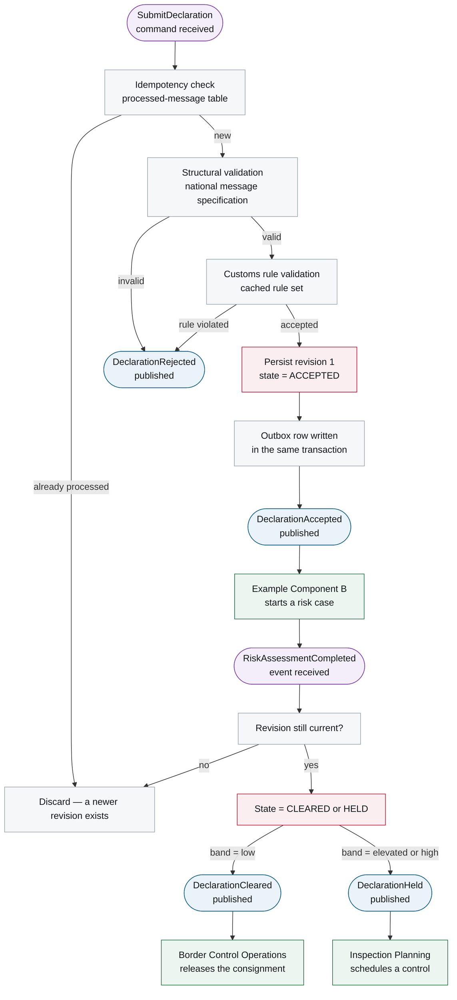
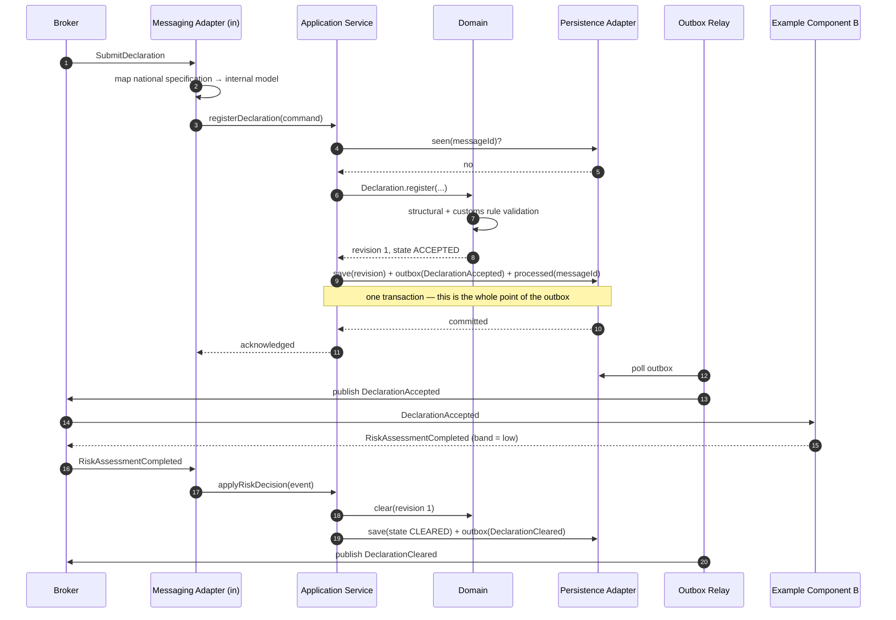

# 6. Runtime View

<DocHeader
  structure="system-architecture"
  system="example-system-a"
  component="example-component-a"
  section="runtime-view"
  generated={{
    generator: 'bazg-archdoc 0.7.2',
    sourceRepo: 'git.example.admin.ch/bazg-proto/declaration-intake-service',
    revision: '9c1e40d',
    generatedAt: '2026-08-04 03:12 UTC',
    scope: 'Whole page — reaction graph, reaction table and the derived sequence',
  }}
/>

:::info[Fully generated page]

Derived from the component's message handlers: which message triggers which use case, what it
changes and what it publishes. The scenarios that had to be *designed* rather than derived are
hand-written pages below this section.

:::

## Generated reaction graph

The reaction graph is derived from the component's message handlers: which message triggers which
use case, what the use case changes, and what it publishes as a result. It is the fastest way to
answer "what happens when this arrives?" without reading the code.

<Diagram
  title="Reaction graph — command to downstream reaction"
  status="generated"
  source="bazg-archdoc 0.7.2 · declaration-intake-service@9c1e40d"
  caption="Every path starts with an inbound message and ends either in a published event or in a terminal rejection. Rounded nodes are messages; rectangles are processing steps."

>

</Diagram>

### Reactions in table form

<Diagram
  title="Message reactions"
  status="generated"
  source="bazg-archdoc 0.7.2 · declaration-intake-service@9c1e40d"
  caption="Each row is one message handler. Follow a message name to its contract page below the system's building block view.">

| Trigger | Use case | State change | Publishes |
| --- | --- | --- | --- |
| <Msg system="example-system-a" name="SubmitDeclaration" /> | Register declaration | New declaration, revision 1, `ACCEPTED` | <Msg system="example-system-a" name="DeclarationAccepted" /> or <Msg system="example-system-a" name="DeclarationRejected" /> |
| <Msg system="example-system-a" name="CorrectDeclaration" /> | Correct declaration | New revision, previous decision invalidated | <Msg system="example-system-a" name="DeclarationAmended" /> or <Msg system="example-system-a" name="DeclarationRejected" /> |
| <Msg system="example-system-a" name="RiskAssessmentCompleted" /> | Apply risk decision | `CLEARED` or `HELD` | <Msg system="example-system-a" name="DeclarationCleared" /> or <Msg system="example-system-a" name="DeclarationHeld" /> |

</Diagram>

## Scenario — submission to clearance

The reaction graph shows what reacts to what; this sequence shows the same flow with the internal
building blocks, which is what you need when something goes wrong in the middle.

## Failure behaviour

Replay, dead-lettering and the outbox relay's failure modes are documented separately in
[Failover and Replay](/systems/example-system-a/system-architecture/building-block-view/components/example-component-a/component-architecture/runtime-view/failover-and-replay/).

<RelatedDocs
  items={[
    {
      to: '/systems/example-system-a/system-architecture/building-block-view/components/example-component-a/component-architecture/runtime-view/failover-and-replay/',
      label: 'Failover and Replay',
      note: 'Custom operational scenario below this arc42 section.',
      status: 'custom',
    },
    {
      to: '/systems/example-system-a/system-architecture/building-block-view/',
      label: 'Events and Commands',
      note: 'Contracts for every message in the graphs above.',
      status: 'generated',
    },
    {
      to: '/systems/example-system-a/system-architecture/building-block-view/components/example-component-b/component-architecture/runtime-view/',
      label: 'Example Component B — 6. Runtime View',
      note: 'The other half of the conversation.',
      status: 'generated',
    },
    {
      to: '/systems/example-system-a/system-architecture/runtime-view/',
      label: 'Example System A — 6. Runtime View',
      note: 'The same flows at system level.',
      status: 'custom',
    },
  ]}
/>
