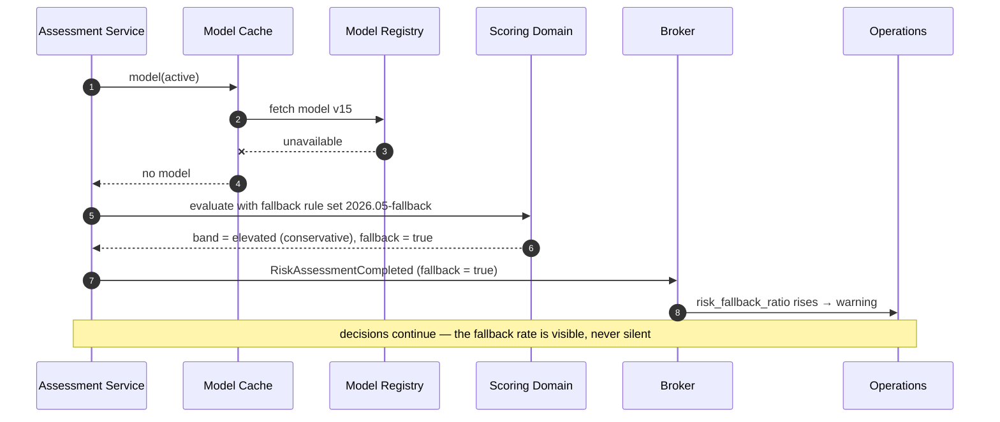

# Fallback Scenario

<DocHeader
  structure="system-architecture"
  system="example-system-a"
  component="example-component-b"
  section="runtime-view"
  custom={{
    owner: 'Team Alpha — Risk Squad (fictional)',
    lastReviewed: '2026-07-28',
    reviewStatus: 'Reviewed',
  }}
/>

:::note[Custom runtime scenario]

A designed scenario, not a derived one. The generator produces the
[reaction graph](/systems/example-system-a/system-architecture/building-block-view/components/example-component-b/component-architecture/runtime-view/) from the handlers; it cannot know
which race conditions are worth writing down.

:::

The fallback is deliberately conservative: it errs towards `elevated`, which costs inspection
capacity rather than control effectiveness. The reasoning is in
[4. Solution Strategy](/systems/example-system-a/system-architecture/building-block-view/components/example-component-b/component-architecture/solution-strategy/).

<RelatedDocs
  items={[
    {
      to: '/systems/example-system-a/system-architecture/building-block-view/components/example-component-b/component-architecture/runtime-view/',
      label: '6. Runtime View',
      note: 'The generated reaction graph.',
      status: 'generated',
    },
    {
      to: '/systems/example-system-a/system-architecture/building-block-view/',
      label: 'Events and Commands',
      note: 'Contracts of the messages in this scenario.',
      status: 'generated',
    },
  ]}
/>
