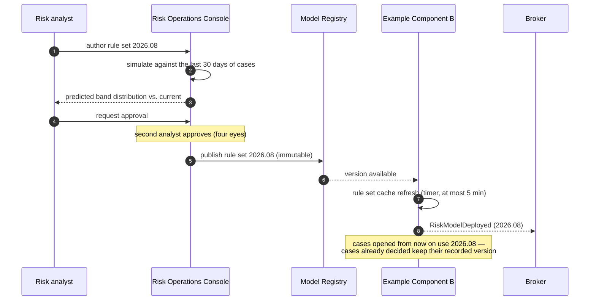
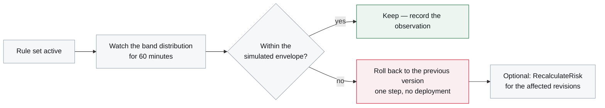

# Rule Set Rollout

<DocHeader
  structure="system-architecture"
  system="example-system-a"
  component="example-component-b"
  section="runtime-view"
  custom={{
    owner: 'Team Alpha — Risk Squad with the specialist unit (fictional)',
    lastReviewed: '2026-07-05',
    reviewStatus: 'Reviewed',
  }}
/>

:::note[Custom operational scenario]
Hand-written, owned jointly by the engineering team and the specialist unit. It documents a
procedure that risk analysts execute — no generator produces it.

:::

## Who does what

| Step | Who | Where |
| --- | --- | --- |
| Author and simulate a rule set | Risk analyst | Risk Operations Console |
| Approve | Second risk analyst (four eyes) | Risk Operations Console |
| Publish version | Risk analyst | Model Registry |
| Observe the band distribution | Risk analyst and operations | *Risk decisions* dashboard |
| Roll back | Risk analyst | Model Registry, one step |

No engineer is involved, which is the point of constraint **O-3**.

## Rollout sequence

## Simulation before publication

A rule set is simulated against the last 30 days of real cases before it can be approved. The
console shows the predicted band distribution next to the current one. A rule set that moves the
`high` band by more than five percentage points requires an explicit justification — this is the
control against risk **R-1** in
[Example System A — 11. Risks and Technical Debt](/systems/example-system-a/system-architecture/risks-and-technical-debt/).

## After publication

Rolling back activates the previous immutable version. Decisions already taken keep the version
they were taken with — they are not retroactively changed, because that would break
reproducibility. If affected consignments need a new decision, the analyst issues
<Msg system="example-system-a" name="RecalculateRisk" />, which
produces a **new** decision with a new identifier rather than replacing the old one.

## Model rollout

Scoring models follow the same path with two differences: the simulation window is 90 days, and a
model is shadow-scored for a week — evaluated in parallel without affecting decisions — before it
can be activated. Shadow decisions are recorded with `shadow = true` and never leave the
component.

<RelatedDocs
  items={[
    {to: '/systems/example-system-a/system-architecture/building-block-view/example-component-b/component-architecture/runtime-view/', label: '6. Runtime View', note: 'The parent arc42 section.', status: 'generated'},
    {to: '/systems/example-system-a/system-architecture/building-block-view/example-component-b/component-architecture/architecture-decisions/adr-0001-versioned-rule-sets/', label: 'ADR-0001 — Versioned rule sets and models', note: 'Why versions are immutable.', status: 'custom'},
    {to: '/systems/example-system-a/system-architecture/crosscutting-concerns/operations-and-monitoring/', label: 'Operations and Monitoring', note: 'The dashboard used to watch a rollout.', status: 'custom'},
  ]}
/>
