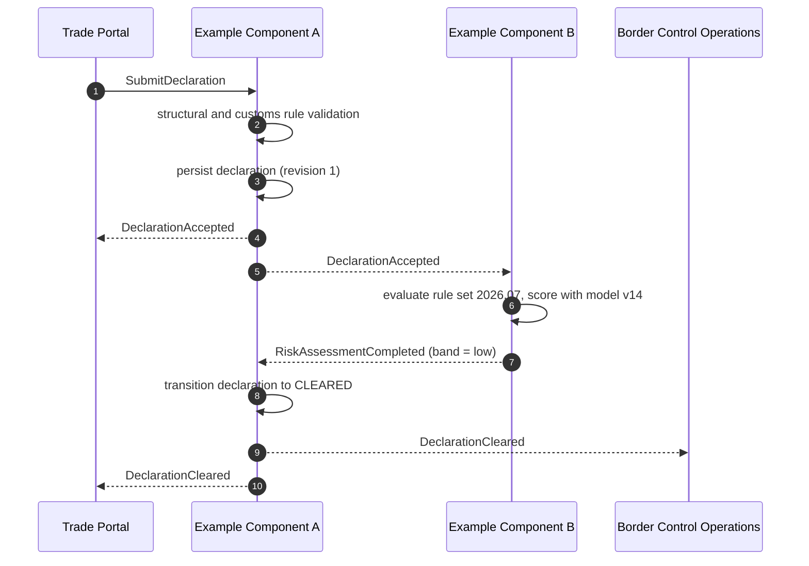
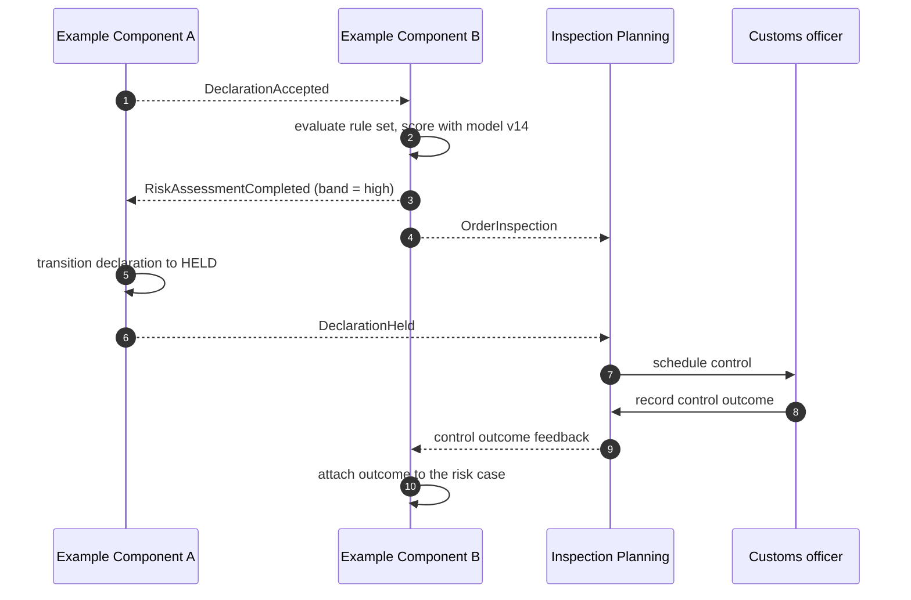
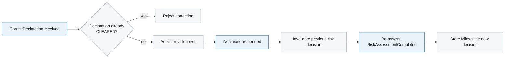

# 6. Runtime View

<DocHeader
  structure="system-architecture"
  system="example-system-a"
  section="runtime-view"
  custom={{
    owner: 'Team Alpha — Customs Platform Engineering (fictional)',
    lastReviewed: '2026-07-30',
    reviewStatus: 'Reviewed',
  }}
/>

This section shows the system-level flows across both components. The component-internal
behaviour is documented in each component's own runtime view, linked at the bottom of the page.

## Scenario 1 — declaration cleared without control

The normal case, and the one that dominates the volume.

The two components never call each other. Every arrow marked `-->>` is a durable message on the
central broker, which is what keeps intake available when the risk engine is not.

## Scenario 2 — consignment withheld for inspection

The control outcome flows back to the risk engine rather than to intake: the risk case owns the
evidence, and the declaration only needs to know that it was held.

## Scenario 3 — correction of an accepted declaration

A correction resets the risk decision. This is the scenario that makes the eventual consistency
of the declaration state visible to the business.

## Failure and load behaviour

The behaviour under an unavailable downstream and under peak load is a separate custom page, so
that the happy-path scenarios above stay readable:
[Peak Load and Degradation](/systems/example-system-a/system-architecture/runtime-view/peak-load-and-degradation/).

<RelatedDocs
  items={[
    {
      to: '/systems/example-system-a/system-architecture/runtime-view/peak-load-and-degradation/',
      label: 'Peak Load and Degradation',
      note: 'Custom operational scenario below this arc42 section.',
      status: 'custom',
    },
    {
      to: '/systems/example-system-a/components/example-component-a/system-architecture/runtime-view/',
      label: 'Example Component A — 6. Runtime View',
      note: 'Generated reaction graph for the intake component.',
      status: 'generated',
    },
    {
      to: '/systems/example-system-a/components/example-component-b/system-architecture/runtime-view/',
      label: 'Example Component B — 6. Runtime View',
      note: 'Generated reaction graph for the risk engine.',
      status: 'generated',
    },
    {
      to: '/systems/example-system-a/system-architecture/building-block-view/',
      label: 'Events and Commands',
      note: 'Contracts of the messages used above.',
      status: 'generated',
    },
  ]}
/>
