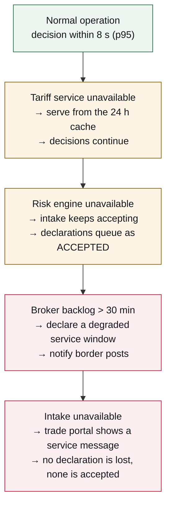
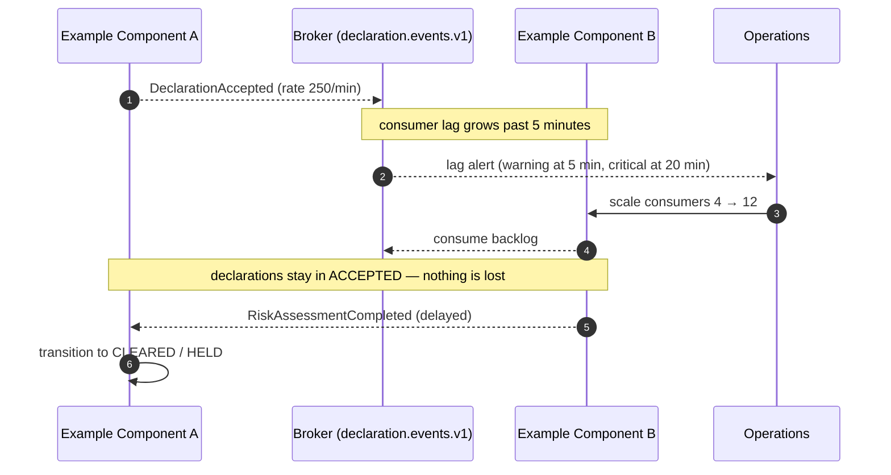

# Peak Load and Degradation

<DocHeader
  structure="system-architecture"
  system="example-system-a"
  section="runtime-view"
  custom={{
    owner: 'Team Alpha — Customs Platform Engineering (fictional)',
    lastReviewed: '2026-07-12',
    reviewStatus: 'Reviewed',
  }}
/>

:::note[Custom operational scenario]
A hand-written page filed under *6. Runtime View*, next to the generated and manually written
happy-path scenarios. Operations reviews this page; no generator touches it.

:::

## The load profile is not flat

Declaration volume is concentrated between 05:00 and 09:00, with a pronounced Monday peak and a
seasonal peak before public holidays. The system is sized for the burst, not the average.

| Window | Declarations / hour | Notes |
| --- | --- | --- |
| 05:00–09:00 workdays | 4 000 sustained, 250/min bursts | Sizing case. |
| 09:00–18:00 | 900 average | Comfortable. |
| Night | < 100 | Maintenance window 01:00–03:00. |

## Degradation ladder

The system sheds capability in a defined order rather than failing as a whole. Each step is
observable and alerted — see
[Operations and Monitoring](/systems/example-system-a/system-architecture/crosscutting-concerns/operations-and-monitoring/).

The important property: **nothing in this ladder loses a declaration.** A declaration is either
rejected with a reason or durably accepted. There is no state in which a declarant believes a
declaration was submitted and the system has no record of it.

## When the risk engine is behind

## Recovery procedure

1. Confirm the backlog is a consumer-side problem, not a broker problem (dashboard *Broker
   health*).
2. Scale the affected consumer group; the runbook allows scaling up to 16 consumers without
   approval.
3. If the backlog does not drain within 15 minutes, declare a degraded service window and inform
   the border posts.
4. After recovery, verify that no message landed in the dead-letter topic. Replay is documented
   in [Failover and Replay](/systems/example-system-a/system-architecture/building-block-view/example-component-a/component-architecture/runtime-view/failover-and-replay/).

<RelatedDocs
  items={[
    {
      to: '/systems/example-system-a/system-architecture/runtime-view/',
      label: '6. Runtime View',
      note: 'The parent arc42 section with the happy-path scenarios.',
      status: 'custom',
    },
    {
      to: '/systems/example-system-a/system-architecture/crosscutting-concerns/operations-and-monitoring/',
      label: 'Operations and Monitoring',
      note: 'The alerts referenced above.',
      status: 'custom',
    },
    {
      to: '/systems/example-system-a/system-architecture/quality-requirements/',
      label: '10. Quality Requirements',
      note: 'The load and latency figures this page has to meet.',
      status: 'custom',
    },
  ]}
/>
