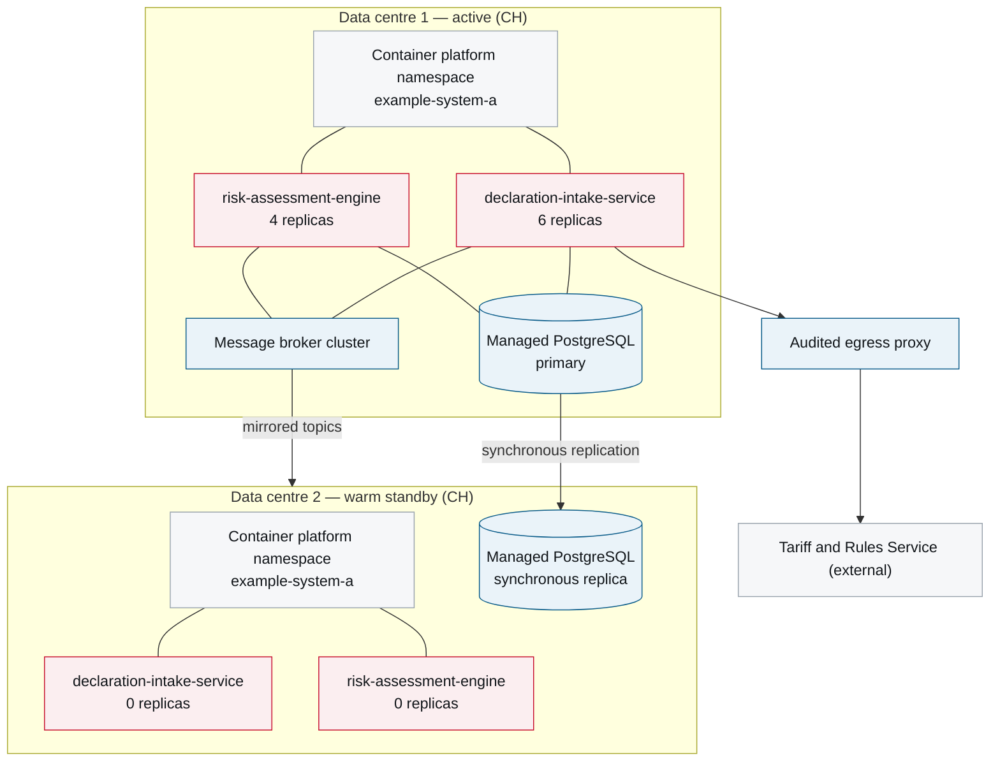

# 7. Deployment View

<DocHeader
  structure="system-architecture"
  system="example-system-a"
  section="deployment-view"
  generated={{
    generator: 'bazg-deploydoc 0.3.5',
    sourceRepo: 'git.example.admin.ch/bazg-proto/example-system-a-deployment',
    revision: 'ff02b7c',
    generatedAt: '2026-08-04 03:15 UTC',
    scope: 'Whole page — topology, environments and operational properties',
  }}
/>

:::info[Fully generated page]

Produced from the deployment descriptors. Why the second site is warm standby rather than active
is an architecture decision, recorded in
[ADR-0002](/systems/example-system-a/system-architecture/architecture-decisions/adr-0002-hosting-and-data-residency/).

:::

## Infrastructure

<Diagram
  title="Deployment topology — production"
  status="generated"
  source="bazg-deploydoc 0.3.5 · example-system-a-deployment@ff02b7c"
  caption="Generated from the deployment descriptors. Replica counts are the configured baseline, not the current autoscaled state.">

</Diagram>

## Environments

<Diagram
  title="Environments"
  status="generated"
  source="bazg-deploydoc 0.3.5 · example-system-a-deployment@ff02b7c"
  caption="Extracted from the environment definitions in the deployment repository.">

| Environment | Purpose | Data | Sizing | Deployed from |
| --- | --- | --- | --- | --- |
| `dev` | Team integration | Synthetic only | 1 replica each | Every merge to `main` |
| `test` | Specialist unit acceptance | Anonymised extract | 2 replicas each | Manual promotion |
| `staging` | Release verification, load tests | Anonymised extract, production volume | Production sizing | Release candidate tag |
| `prod` | Operation | Production | See topology above | Release tag, four-eyes approval |

</Diagram>

## Operational properties

| Property | Value |
| --- | --- |
| Recovery time objective | 30 minutes (site failure) |
| Recovery point objective | 0 for accepted declarations (synchronous replication) |
| Deployment strategy | Rolling, one replica at a time, health-gated |
| Maintenance window | 01:00–03:00 CET, database patching only |
| Scaling trigger | Broker consumer lag and CPU; documented in the runbook |

<RelatedDocs
  items={[
    {
      to: '/systems/example-system-a/components/example-component-a/system-architecture/deployment-view/',
      label: 'Example Component A — 7. Deployment View',
      note: 'Component-level deployment detail.',
      status: 'generated',
    },
    {
      to: '/systems/example-system-a/system-architecture/architecture-decisions/adr-0002-hosting-and-data-residency/',
      label: 'ADR-0002 — Hosting and data residency',
      note: 'Why both sites are in Switzerland and why standby is warm.',
      status: 'custom',
    },
    {
      to: '/systems/example-system-a/system-architecture/crosscutting-concerns/operations-and-monitoring/',
      label: 'Operations and Monitoring',
      note: 'Alerting, dashboards and the failover procedure.',
      status: 'custom',
    },
  ]}
/>
