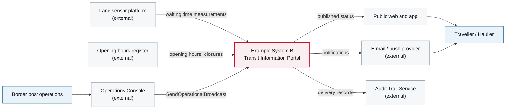

# 3. Context and Scope

<DocHeader structure="system-architecture" system="example-system-b" section="context-and-scope"
  generated={{
    generator: 'acme-archdoc 0.7.2',
    sourceRepo: 'git.example.com/acme-proto/example-system-b',
    revision: '7b20ae1',
    generatedAt: '2026-08-03 03:09 UTC',
    scope: 'Context diagram',
  }}
/>

:::info[Fully generated page]

Derived from the system's interface descriptors. What the system deliberately does *not* own is
stated in [1. Introduction and Goals](/systems/example-system-b/system-architecture/introduction-and-goals/).

:::

<Diagram
  title="System context — Example System B"
  status="generated"
  source="acme-archdoc 0.7.2 · example-system-b@7b20ae1"
  caption="Sources on the left, channels on the right. The system only ever republishes.">

</Diagram>

<RelatedDocs items={[
  {to: '/systems/example-system-b/system-architecture/building-block-view/', label: '5. Building Block View', status: 'generated'},
  {to: '/systems/example-system-b/system-architecture/building-block-view/components/example-component-c/component-architecture/context-and-scope/', label: 'Example Component C — 3. Context and Scope', status: 'generated'},
]} />
