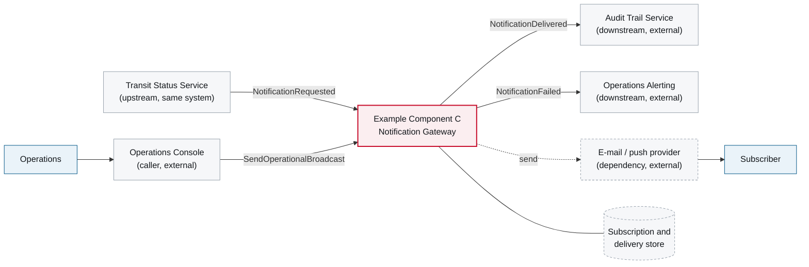

# 3. Context and Scope

<DocHeader structure="system-architecture" system="example-system-b" component="example-component-c" section="context-and-scope"
  generated={{
    generator: 'bazg-archdoc 0.7.2',
    sourceRepo: 'git.example.admin.ch/bazg-proto/notification-gateway',
    revision: 'd52c118',
    generatedAt: '2026-08-03 03:10 UTC',
    scope: 'Context diagram',
  }}
/>

<Diagram
  title="Component context — Example Component C"
  status="generated"
  source="bazg-archdoc 0.7.2 · notification-gateway@d52c118"
  caption="Solid arrows are broker messages, dashed arrows are synchronous calls.">

</Diagram>

<RelatedDocs items={[
  {to: '/systems/example-system-b/system-architecture/building-block-view/', label: 'Events and Commands', status: 'generated'},
  {to: '/systems/example-system-b/system-architecture/building-block-view/example-component-c/component-architecture/building-block-view/', label: '5. Building Block View', status: 'generated'},
]} />
