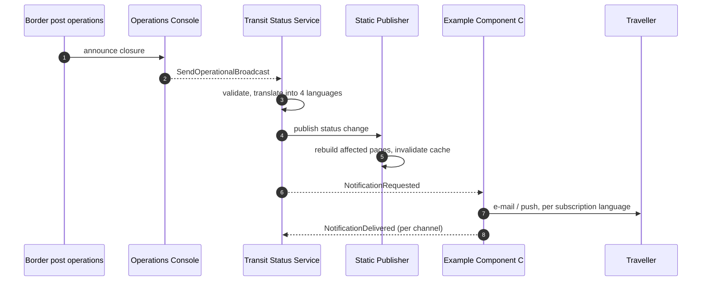
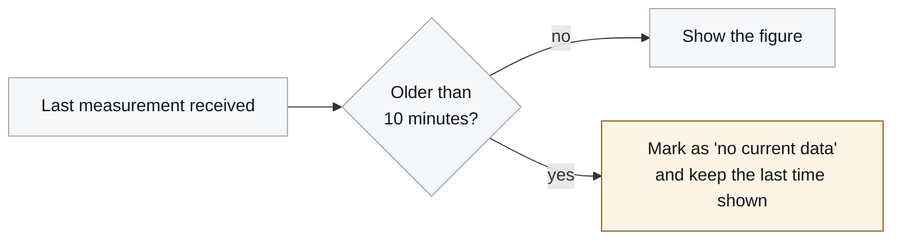

# 6. Runtime View

<DocHeader structure="system-architecture" system="example-system-b" section="runtime-view"
  custom={{owner: 'Team Beta — Public Information Services (fictional)', lastReviewed: '2026-07-11'}} />

## Scenario — unplanned lane closure

## Scenario — measurement goes stale

Showing "no current data" rather than the last known value is the first quality goal in action.

<RelatedDocs items={[
  {to: '/systems/example-system-b/system-architecture/building-block-view/components/example-component-c/component-architecture/runtime-view/', label: 'Example Component C — 6. Runtime View', status: 'generated'},
  {to: '/systems/example-system-b/system-architecture/quality-requirements/', label: '10. Quality Requirements', status: 'custom'},
]} />
