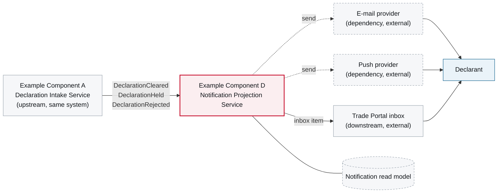

# 3. Context and Scope

<DocHeader
  structure="system-architecture"
  system="example-system-a"
  component="example-component-d"
  section="context-and-scope"
  generated={{
    generator: 'bazg-archdoc 0.7.2',
    sourceRepo: 'git.example.admin.ch/bazg-proto/notification-projection-service',
    revision: '0b74e12',
    generatedAt: '2026-08-06 06:00 UTC',
    scope: 'Whole page — context diagram and relationship tables',
  }}
/>

:::info[Fully generated page]

Derived from the component's message subscriptions and outbound client configurations.

:::

<Diagram
  title="Component context — Example Component D"
  status="generated"
  source="bazg-archdoc 0.7.2 · notification-projection-service@0b74e12"
  caption="Solid arrows are message flows on the broker, dashed arrows are synchronous calls.">

</Diagram>

## Inbound

<Diagram title="Inbound" status="generated" source="bazg-msgdoc 0.4.1 · notification-projection-service@0b74e12">

| From | What | Transport |
| --- | --- | --- |
| Example Component A | <Msg system="example-system-a" name="DeclarationCleared" /> | Broker |
| Example Component A | <Msg system="example-system-a" name="DeclarationHeld" /> | Broker |
| Example Component A | <Msg system="example-system-a" name="DeclarationRejected" /> | Broker |

</Diagram>

## Outbound

<Diagram title="Outbound" status="generated" source="bazg-archdoc 0.7.2 · notification-projection-service@0b74e12">

| To | What | Transport |
| --- | --- | --- |
| E-mail provider | Rendered notification | HTTPS via the egress proxy |
| Push provider | Rendered notification | HTTPS via the egress proxy |
| Trade Portal inbox | Inbox item | HTTPS |

</Diagram>

<RelatedDocs
  items={[
    {
      to: '/systems/example-system-a/system-architecture/building-block-view/components/example-component-d/component-architecture/building-block-view/',
      label: '5. Building Block View',
      note: 'What is inside the red box.',
      status: 'generated',
    },
    {
      to: '/systems/example-system-a/system-architecture/building-block-view/',
      label: 'Example System A — 5. Building Block View',
      note: 'The contracts it consumes.',
      status: 'generated',
    },
  ]}
/>
