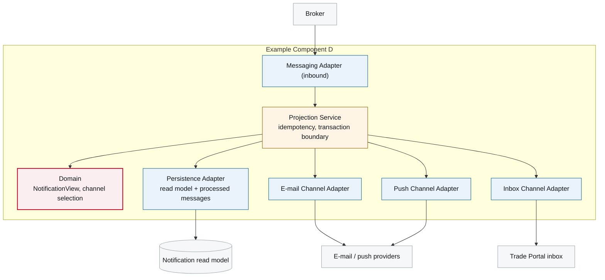

# 5. Building Block View

<DocHeader
  structure="system-architecture"
  system="example-system-a"
  component="example-component-d"
  section="building-block-view"
  generated={{
    generator: 'acme-archdoc 0.7.2',
    sourceRepo: 'git.example.com/acme-proto/notification-projection-service',
    revision: '0b74e12',
    generatedAt: '2026-08-06 06:00 UTC',
    scope: 'Whole page — internal component view and the building block table',
  }}
/>

:::info[Fully generated page]

Derived from the package structure and the declared ports.

:::

<Diagram
  title="Internal component view — Example Component D"
  status="generated"
  source="acme-archdoc 0.7.2 · notification-projection-service@0b74e12">

</Diagram>

| Building block | Responsibility |
| --- | --- |
| **Messaging Adapter (inbound)** | Deserialises declaration lifecycle events. |
| **Projection Service** | Updates the read model and dispatches to channels in one transaction boundary; idempotent per (event, channel). |
| **Domain** | Which channels a declarant gets, and what the notification says. No framework imports. |
| **Persistence Adapter** | Notification read model and the processed-message table. |
| **Channel adapters** | One per channel, behind a single port — the reason this component exists. |

## Messages this component handles

<ComponentMessages system="example-system-a" component="example-component-d" />

<RelatedDocs
  items={[
    {
      to: '/systems/example-system-a/system-architecture/building-block-view/components/example-component-d/component-architecture/runtime-view/',
      label: '6. Runtime View',
      note: 'These blocks in motion.',
      status: 'generated',
    },
  ]}
/>
