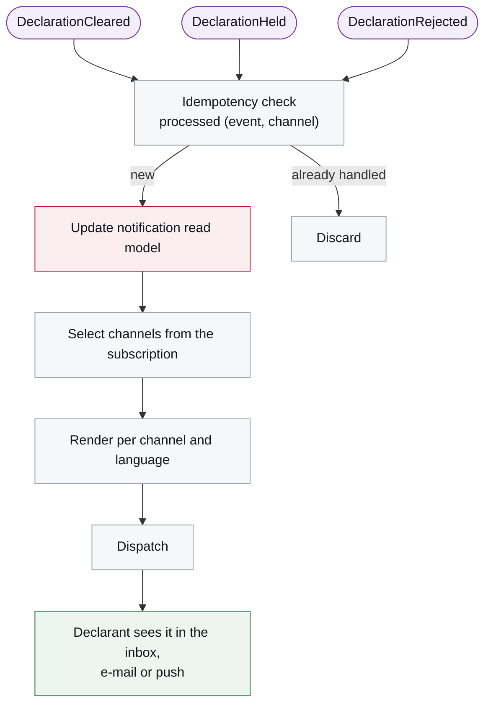
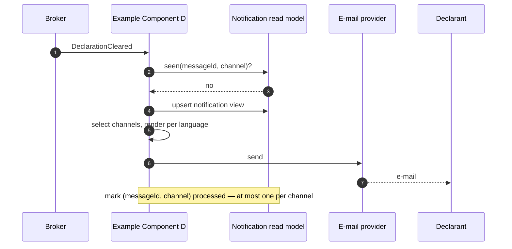

# 6. Runtime View

<DocHeader
  structure="system-architecture"
  system="example-system-a"
  component="example-component-d"
  section="runtime-view"
  generated={{
    generator: 'acme-archdoc 0.7.2',
    sourceRepo: 'git.example.com/acme-proto/notification-projection-service',
    revision: '0b74e12',
    generatedAt: '2026-08-06 06:00 UTC',
    scope: 'Whole page — reaction graph and reaction table',
  }}
/>

:::info[Fully generated page]

Derived from the component's message handlers.

:::

<Diagram
  title="Reaction graph — event to notification"
  status="generated"
  source="acme-archdoc 0.7.2 · notification-projection-service@0b74e12"
  caption="Rounded nodes are messages; rectangles are processing steps.">

</Diagram>

| Trigger | Use case | Result |
| --- | --- | --- |
| <Msg system="example-system-a" name="DeclarationCleared" /> | Notify clearance | Inbox item plus opted-in channels |
| <Msg system="example-system-a" name="DeclarationHeld" /> | Notify hold | Inbox item plus opted-in channels |
| <Msg system="example-system-a" name="DeclarationRejected" /> | Notify rejection with the violated rules | Inbox item plus opted-in channels |

## Scenario — clearance reaches the declarant

<RelatedDocs
  items={[
    {
      to: '/systems/example-system-a/system-architecture/building-block-view/components/example-component-d/component-architecture/context-and-scope/',
      label: '3. Context and Scope',
      note: 'Who it talks to.',
      status: 'generated',
    },
  ]}
/>
