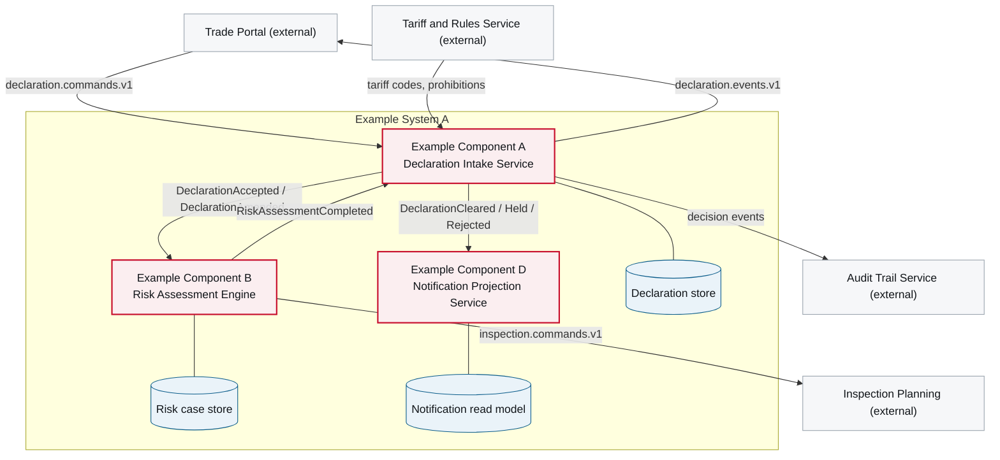

# 5. Building Block View

<DocHeader
  structure="system-architecture"
  system="example-system-a"
  section="building-block-view"
  generated={{
    generator: 'bazg-archdoc 0.7.2',
    sourceRepo: 'git.example.admin.ch/bazg-proto/example-system-a',
    revision: 'a41f7c9',
    generatedAt: '2026-08-04 03:12 UTC',
    scope: 'Whole page — component diagram, component list and responsibility table',
  }}
/>

:::info[Three components on DEV]

The notification projection was extracted from Example Component A into
[Example Component D](/systems/example-system-a/system-architecture/building-block-view/components/example-component-d/). That has happened
on **DEV** only — on REF, ABN and PROD this system still has two components, and their building
block views show exactly that.

:::

:::info[Fully generated page]

Derived from the component descriptors and the contract definitions of the system. Why the system
is cut this way, and why the decomposition stops where it does, is written by hand in
[Decomposition Rationale](/systems/example-system-a/system-architecture/building-block-view/decomposition-rationale/).

:::

## Level 1 — decomposition into components

<Diagram
  title="Component diagram — Example System A"
  status="generated"
  source="bazg-archdoc 0.7.2 · example-system-a@a41f7c9"
  caption="Deployable components of the system and the channels between them. External neighbours are shown in grey.">

</Diagram>

## Contained components

Each component is documented in full under `Components`, one level below this section — twelve
arc42 sections each.

<CardGrid>
  <ComponentCard system="example-system-a" component="example-component-a" />
  <ComponentCard system="example-system-a" component="example-component-b" />
  <ComponentCard system="example-system-a" component="example-component-d" />
</CardGrid>

### Responsibilities and interfaces

<Diagram
  title="Component responsibilities"
  status="generated"
  source="bazg-archdoc 0.7.2 · example-system-a@a41f7c9"
  caption="Generated from the component descriptors. The documentation column counts the pages of each origin currently published for that component.">

| Component | Responsibility | Consumes | Publishes | Documentation |
| --- | --- | --- | --- | --- |
| [Example Component A](/systems/example-system-a/system-architecture/building-block-view/components/example-component-a/) | Owns the declaration aggregate and its lifecycle: validation, persistence, state transitions. | `SubmitDeclaration`, `CorrectDeclaration`, `RiskAssessmentCompleted` | `DeclarationAccepted`, `DeclarationRejected`, `DeclarationAmended`, `DeclarationCleared`, `DeclarationHeld` | <DocMix system="example-system-a" component="example-component-a" /> |
| [Example Component B](/systems/example-system-a/system-architecture/building-block-view/components/example-component-b/) | Owns the risk decision: rule evaluation, scoring, inspection orders. | `DeclarationAccepted`, `DeclarationAmended`, `RecalculateRisk` | `RiskAssessmentCompleted`, `OrderInspection`, `RiskModelDeployed` | <DocMix system="example-system-a" component="example-component-b" /> |
| [Example Component D](/systems/example-system-a/system-architecture/building-block-view/components/example-component-d/) | Projects declaration lifecycle events into declarant notifications. | `DeclarationCleared`, `DeclarationHeld`, `DeclarationRejected` | — | <DocMix system="example-system-a" component="example-component-d" /> |

</Diagram>

## Events and commands

Message contracts are defined by the **system**, not by a single component: several components
produce and consume the same contract, and its lifecycle is longer than any one of them. They are
therefore documented here, where the building blocks and the flows between them are described —
one page per contract, directly below this section.

<MessagingCatalogue system="example-system-a" />

## Level 2

The internal structure of each component is documented in the component's own building block
view, not here — that keeps this page about the system and lets each component's page carry its
generated internal decomposition:

- [Example Component A — 5. Building Block View](/systems/example-system-a/system-architecture/building-block-view/components/example-component-a/component-architecture/building-block-view/)
- [Example Component B — 5. Building Block View](/systems/example-system-a/system-architecture/building-block-view/components/example-component-b/component-architecture/building-block-view/)

<RelatedDocs
  items={[
    {
      to: '/systems/example-system-a/system-architecture/building-block-view/decomposition-rationale/',
      label: 'Decomposition Rationale',
      note: 'Why the system is cut this way, and where the decomposition stops.',
      status: 'custom',
    },
    {
      to: '/systems/example-system-a/system-architecture/runtime-view/',
      label: '6. Runtime View',
      note: 'These blocks in motion, end to end.',
      status: 'custom',
    },
    {
      to: '/systems/example-system-a/system-architecture/building-block-view/',
      label: 'Events and Commands',
      note: 'The contracts on the arrows above.',
      status: 'generated',
    },
    {
      to: '/systems/example-system-a/system-architecture/building-block-view/',
      label: 'Events and Commands',
      note: 'The contracts on the arrows above.',
      status: 'generated',
    },
    {
      to: '/systems/example-system-a/system-architecture/deployment-view/',
      label: '7. Deployment View',
      note: 'Where these components run.',
      status: 'generated',
    },
  ]}
/>
