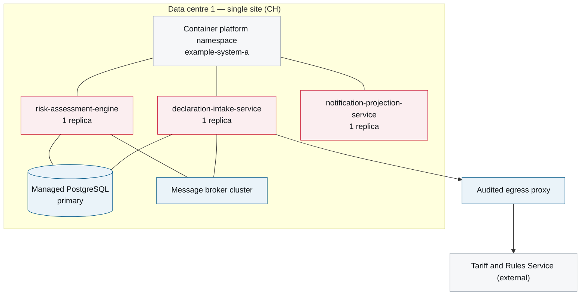

# 7. Deployment View

<DocHeader
  structure="system-architecture"
  system="example-system-a"
  section="deployment-view"
  generated={{
    generator: 'acme-deploydoc 0.3.5',
    sourceRepo: 'git.example.com/acme-proto/example-system-a-deployment',
    revision: 'ff02b7c',
    generatedAt: '2026-08-04 03:15 UTC',
    scope: 'Whole page — topology, environments and operational properties',
  }}
/>

:::info[Fully generated page]

Produced from the DEV deployment descriptors. DEV runs on a single site with one replica per
workload; the two-site topology described in
[ADR-0002](/systems/example-system-a/system-architecture/architecture-decisions/adr-0002-hosting-and-data-residency/)
applies from REF upwards.

:::

## Infrastructure

<Diagram
  title="Deployment topology — production"
  status="generated"
  source="acme-deploydoc 0.3.5 · example-system-a-deployment@ff02b7c"
  caption="Generated from the deployment descriptors. Replica counts are the configured baseline, not the current autoscaled state.">

</Diagram>

## Environments

<Diagram
  title="Environments"
  status="generated"
  source="acme-deploydoc 0.3.5 · example-system-a-deployment@ff02b7c"
  caption="Extracted from the environment definitions in the deployment repository.">

| Property | Value on DEV |
| --- | --- |
| Purpose | Team integration |
| Data | Synthetic only |
| Sizing | 1 replica per workload, single site |
| Deployed from | Every merge to `main` |
| Promotion | Manual promotion to REF |

</Diagram>

## Operational properties

| Property | Value |
| --- | --- |
| Recovery time objective | None — DEV is rebuilt, not recovered |
| Recovery point objective | None — synthetic data only |
| Deployment strategy | Recreate |
| Maintenance window | Any time |
| Scaling trigger | None; fixed at one replica |

<RelatedDocs
  items={[
    {
      to: '/systems/example-system-a/system-architecture/building-block-view/components/example-component-a/component-architecture/deployment-view/',
      label: 'Example Component A — 7. Deployment View',
      note: 'Component-level deployment detail.',
      status: 'generated',
    },
    {
      to: '/systems/example-system-a/system-architecture/architecture-decisions/adr-0002-hosting-and-data-residency/',
      label: 'ADR-0002 — Hosting and data residency',
      note: 'Why both sites are in Switzerland and why standby is warm.',
      status: 'custom',
    },
    {
      to: '/systems/example-system-a/system-architecture/crosscutting-concerns/operations-and-monitoring/',
      label: 'Operations and Monitoring',
      note: 'Alerting, dashboards and the failover procedure.',
      status: 'custom',
    },
  ]}
/>
