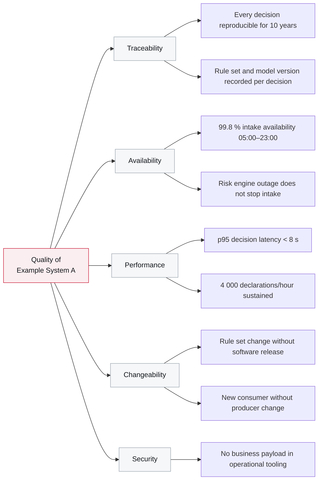

# 10. Quality Requirements

<DocHeader
  system="example-system-a"
  section="quality-requirements"
  custom={{
    owner: 'Team Alpha — Customs Platform Engineering (fictional)',
    lastReviewed: '2026-07-30',
    reviewStatus: 'Reviewed',
  }}
/>

## Quality tree

## Quality scenarios

Each scenario is written so that it can be tested rather than argued about.

| # | Quality | Stimulus | Response | Measure |
| --- | --- | --- | --- | --- |
| QS-1 | Traceability | An auditor asks for the basis of a clearance decision from three years ago. | The decision, its inputs, the rule set version and the model version are retrieved from the event log. | Complete answer within one working day, without a developer. |
| QS-2 | Availability | The risk assessment engine is unavailable for 45 minutes during opening hours. | Intake continues to accept and acknowledge declarations; decisions are produced after recovery. | Zero rejected submissions attributable to the outage; backlog drained within 20 minutes of recovery. |
| QS-3 | Performance | 250 declarations arrive within one minute. | All are accepted and decided. | p95 end-to-end below 8 s, p99 below 30 s, no message dead-lettered. |
| QS-4 | Changeability | A risk analyst publishes a new rule set. | The new rule set becomes effective without a deployment. | Effective within 5 minutes; the version appears in every subsequent decision. |
| QS-5 | Changeability | A new downstream consumer subscribes to `DeclarationCleared`. | No change to the producing component. | Zero lines changed in Example Component A. |
| QS-6 | Security | An operator investigates a dead-lettered message. | Technical metadata is visible; the business payload is not. | Payload access requires a separate, logged authorisation. |
| QS-7 | Robustness | The tariff service is unavailable for two hours. | Validation continues from the cache. | Decisions continue; a warning is raised; cache age is visible on the dashboard. |

## How the scenarios are verified

| Scenario | Verified by |
| --- | --- |
| QS-1 | Semi-annual audit rehearsal with the specialist unit |
| QS-2, QS-7 | Chaos test in `staging` before each release |
| QS-3 | Load test against the peak profile before each release |
| QS-4, QS-5 | Automated in the component test suites |
| QS-6 | Reviewed in the security review, enforced by the architecture test |

<RelatedDocs
  items={[
    {
      to: '/systems/example-system-a/introduction-and-goals/',
      label: '1. Introduction and Goals',
      note: 'The goals these scenarios make measurable.',
      status: 'custom',
    },
    {
      to: '/systems/example-system-a/runtime-view/peak-load-and-degradation/',
      label: 'Peak Load and Degradation',
      note: 'The behaviour behind QS-2, QS-3 and QS-7.',
      status: 'custom',
    },
    {
      to: '/systems/example-system-a/crosscutting-concerns/operations-and-monitoring/',
      label: 'Operations and Monitoring',
      note: 'Where these objectives are measured in production.',
      status: 'custom',
    },
  ]}
/>
