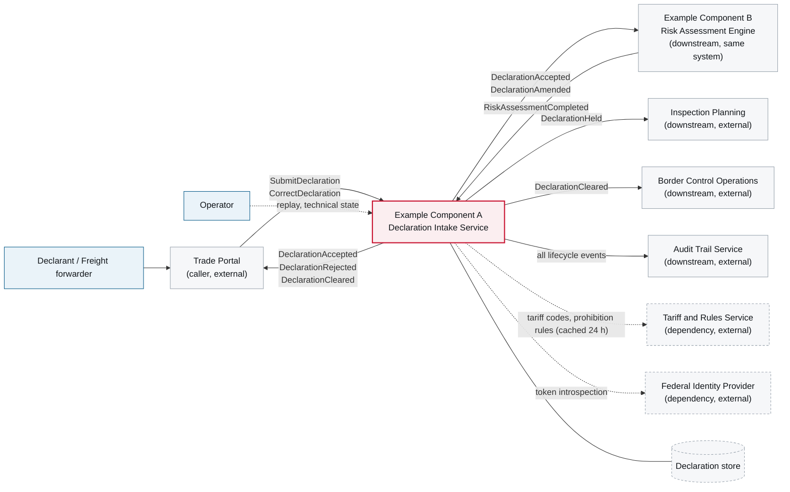

# 3. Context and Scope

<DocHeader
  system="example-system-a"
  component="example-component-a"
  section="context-and-scope"
  status="mixed"
  generated={{
    generator: 'bazg-archdoc 0.7.2',
    sourceRepo: 'git.example.admin.ch/bazg-proto/declaration-intake-service',
    revision: '9c1e40d',
    generatedAt: '2026-08-04 03:12 UTC',
    scope: 'Context diagram and the inbound/outbound relationship tables',
  }}
  custom={{
    owner: 'Team Alpha — Declaration Squad (fictional)',
    lastReviewed: '2026-07-30',
    reviewStatus: 'Reviewed',
  }}
/>

## Reading this page

The diagram below is generated from the component's message subscriptions, published contracts
and outbound client configurations — it is complete by construction and will change without
anybody editing this page. The paragraphs around it are written by hand and explain the parts a
generator cannot know: which relationships are load-bearing and which are incidental.

## Generated context diagram

<Diagram
  title="Component context — Example Component A"
  status="generated"
  source="bazg-archdoc 0.7.2 · declaration-intake-service@9c1e40d"
  caption="Solid arrows are message flows on the broker, dashed arrows are synchronous calls. Direction is from producer to consumer.">

</Diagram>

## Inbound relationships

<Diagram
  title="Inbound"
  status="generated"
  source="bazg-msgdoc 0.4.1 · declaration-intake-service@9c1e40d"
  caption="Generated from the component's message subscriptions and API definitions.">

| From | What | Transport | Contract |
| --- | --- | --- | --- |
| Trade Portal | <Msg system="example-system-a" component="example-component-a" name="SubmitDeclaration" /> | Broker | `declaration/SubmitDeclaration.avsc` 1.3.0 |
| Trade Portal | <Msg system="example-system-a" component="example-component-a" name="CorrectDeclaration" /> | Broker | `declaration/CorrectDeclaration.avsc` 1.1.0 |
| Example Component B | <Msg system="example-system-a" component="example-component-a" name="RiskAssessmentCompleted" /> | Broker | `risk/RiskAssessmentCompleted.avsc` 1.4.0 |
| Operator tooling | Replay and technical state | HTTPS | Internal admin API, role `operator` |

</Diagram>

## Outbound relationships

<Diagram
  title="Outbound"
  status="generated"
  source="bazg-msgdoc 0.4.1 · declaration-intake-service@9c1e40d"
  caption="Generated from the component's published contracts and outbound clients.">

| To | What | Transport | Contract |
| --- | --- | --- | --- |
| Example Component B, Audit | <Msg system="example-system-a" component="example-component-a" name="DeclarationAccepted" /> | Broker | `declaration/DeclarationAccepted.avsc` 2.0.0 |
| Trade Portal, Audit | <Msg system="example-system-a" component="example-component-a" name="DeclarationRejected" /> | Broker | `declaration/DeclarationRejected.avsc` 2.0.0 |
| Example Component B, Audit | <Msg system="example-system-a" component="example-component-a" name="DeclarationAmended" /> | Broker | `declaration/DeclarationAmended.avsc` 1.2.0 |
| Border Control, Audit | <Msg system="example-system-a" component="example-component-a" name="DeclarationCleared" /> | Broker | `declaration/DeclarationCleared.avsc` 1.2.0 |
| Inspection Planning, Audit | <Msg system="example-system-a" component="example-component-a" name="DeclarationHeld" /> | Broker | `declaration/DeclarationHeld.avsc` 1.2.0 |
| Tariff and Rules Service | Rule and tariff lookup | HTTPS via egress proxy | `tariff-api 3.2`, read-only |
| Federal Identity Provider | Token introspection | HTTPS | OIDC discovery |

</Diagram>

## What the diagram does not say

Two things worth knowing that no generator can derive:

- **The Tariff and Rules Service is a soft dependency.** Its arrow looks like every other
  dependency, but the component keeps working from a 24-hour cache when it is unavailable, with a
  visible cache-age warning. Constraint C-3 in
  [2. Architecture Constraints](/systems/example-system-a/components/example-component-a/architecture-constraints/).
- **The relationship to Example Component B is a cycle in the diagram but not in time.** This
  component publishes `DeclarationAccepted` and later consumes `RiskAssessmentCompleted` for the
  same declaration. It is a conversation, not a request; see
  [6. Runtime View](/systems/example-system-a/components/example-component-a/runtime-view/).

<RelatedDocs
  items={[
    {
      to: '/systems/example-system-a/components/example-component-a/crosscutting-concerns/messaging-events-and-commands/',
      label: 'Messaging Events and Commands',
      note: 'Full contract details for every message above.',
      status: 'generated',
    },
    {
      to: '/systems/example-system-a/components/example-component-a/building-block-view/',
      label: '5. Building Block View',
      note: 'What is inside the red box.',
      status: 'mixed',
    },
    {
      to: '/systems/example-system-a/context-and-scope/',
      label: 'Example System A — 3. Context and Scope',
      note: 'The same view one level up.',
      status: 'mixed',
    },
  ]}
/>
