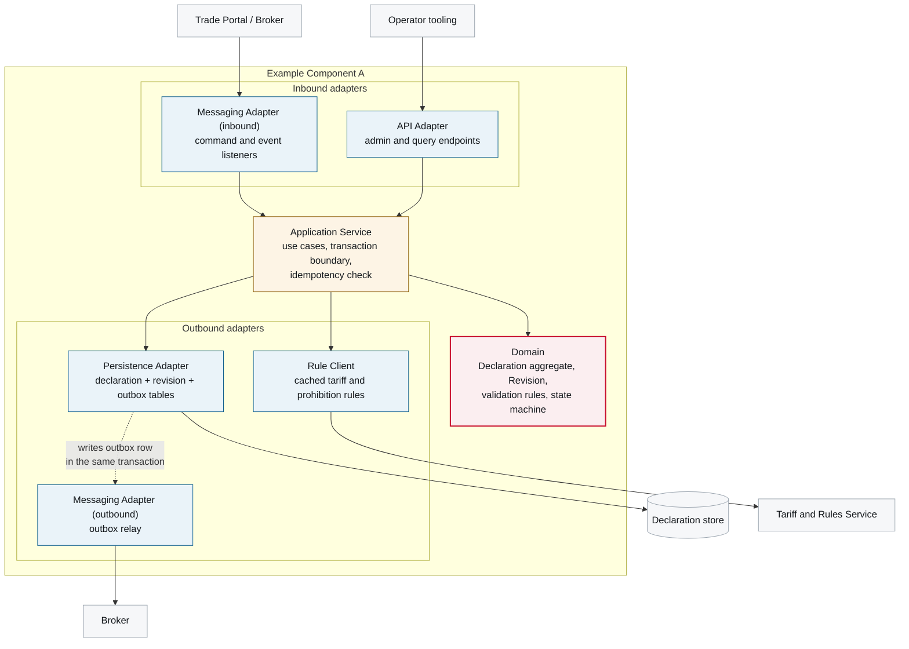

# 5. Building Block View

<DocHeader
  system="example-system-a"
  component="example-component-a"
  section="building-block-view"
  status="mixed"
  generated={{
    generator: 'bazg-archdoc 0.7.2',
    sourceRepo: 'git.example.admin.ch/bazg-proto/declaration-intake-service',
    revision: '9c1e40d',
    generatedAt: '2026-08-04 03:12 UTC',
    scope: 'Internal component view and the building block table',
  }}
  custom={{
    owner: 'Team Alpha — Declaration Squad (fictional)',
    lastReviewed: '2026-07-30',
    reviewStatus: 'Reviewed',
  }}
/>

## Internal structure

The component follows the hexagonal structure mandated by the
[Development Guidelines](/systems/example-system-a/crosscutting-concerns/development-guidelines/):
adapters at the edge, use cases in the middle, domain logic in the centre with no framework
dependencies. The diagram is generated from the package structure and the declared ports, so it
cannot drift from the code.

<Diagram
  title="Internal component view — Example Component A"
  status="generated"
  source="bazg-archdoc 0.7.2 · declaration-intake-service@9c1e40d"
  caption="Building blocks and their dependencies. Arrows point in the direction of the dependency.">

</Diagram>

## Building blocks

<Diagram
  title="Building blocks and responsibilities"
  status="generated"
  source="bazg-archdoc 0.7.2 · declaration-intake-service@9c1e40d"
  caption="Generated from the package structure and the port declarations.">

| Building block | Responsibility | Depends on | Notes |
| --- | --- | --- | --- |
| **API Adapter** | Query endpoints for officers, admin endpoints for operators. No business rules. | Application Service | Authorisation enforced here and re-checked in the application service. |
| **Messaging Adapter (inbound)** | Deserialises commands and events, maps the external national specification onto the internal model, rejects unknown message versions. | Application Service | The anti-corruption layer for constraint O-4. |
| **Application Service** | Use cases, transaction boundary, idempotency check against the processed-message table. | Domain, Persistence Adapter, Rule Client | Every use case is one transaction. |
| **Domain** | `Declaration` aggregate, `Revision` value object, state machine, invariants. | — | No framework imports; enforced by an architecture test. |
| **Persistence Adapter** | Declaration, revision, outbox and processed-message tables. Append-only revisions. | Declaration store | Writes the outbox row inside the business transaction. |
| **Messaging Adapter (outbound)** | Outbox relay: polls, publishes, marks published, retries forever. | Broker | At-least-once by construction. |
| **Rule Client** | Fetches and caches customs and prohibition rules; serves stale with a warning. | Tariff and Rules Service | 24-hour cache; constraint C-3. |

</Diagram>

## The one interesting dependency

Everything above is conventional except the dashed arrow: the **Persistence Adapter writes the
outbox row in the same transaction as the state change**, and the **Messaging Adapter (outbound)
reads it asynchronously**. The two adapters are coupled through a database table rather than
through code, which is the entire point —
[ADR-0001](/systems/example-system-a/components/example-component-a/architecture-decisions/adr-0001-transactional-outbox/)
explains what this buys and what it costs.

## Messaging and runtime behaviour

The building blocks above exchange the messages catalogued in
[Messaging Events and Commands](/systems/example-system-a/components/example-component-a/crosscutting-concerns/messaging-events-and-commands/).
How they interact over time — command in, event out — is documented in
[6. Runtime View](/systems/example-system-a/components/example-component-a/runtime-view/).

<RelatedDocs
  items={[
    {
      to: '/systems/example-system-a/components/example-component-a/crosscutting-concerns/messaging-events-and-commands/',
      label: 'Messaging Events and Commands',
      note: 'The contracts these blocks produce and consume.',
      status: 'generated',
    },
    {
      to: '/systems/example-system-a/components/example-component-a/runtime-view/',
      label: '6. Runtime View',
      note: 'These blocks in motion.',
      status: 'mixed',
    },
    {
      to: '/systems/example-system-a/components/example-component-a/crosscutting-concerns/integration-conventions/',
      label: 'Integration Conventions',
      note: 'Headers, idempotency and versioning rules applied by the adapters.',
      status: 'custom',
    },
    {
      to: '/systems/example-system-a/building-block-view/',
      label: 'Example System A — 5. Building Block View',
      note: 'This component in its system context.',
      status: 'mixed',
    },
  ]}
/>
