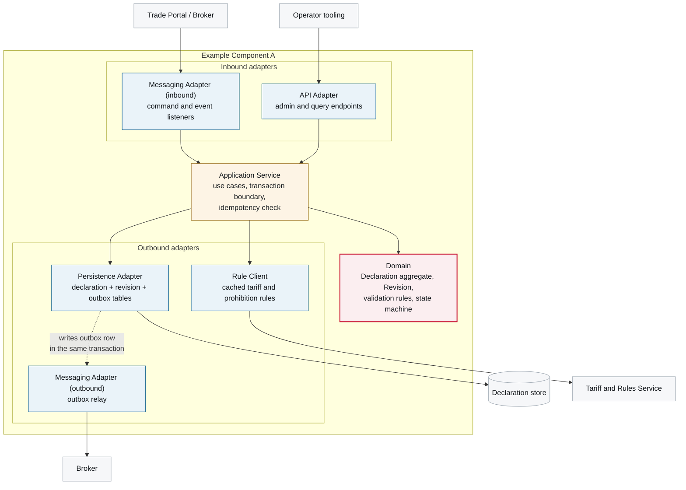

# 5. Building Block View

<DocHeader
  system="example-system-a"
  component="example-component-a"
  section="building-block-view"
  generated={{
    generator: 'bazg-archdoc 0.7.2',
    sourceRepo: 'git.example.admin.ch/bazg-proto/declaration-intake-service',
    revision: '9c1e40d',
    generatedAt: '2026-08-04 03:12 UTC',
    scope: 'Whole page — internal component view and the building block table',
  }}
/>

:::info[Fully generated page]

Derived from the package structure and the declared ports, so it cannot drift from the code. Why
the component is shaped this way is written by hand in
[Design Notes](/systems/example-system-a/components/example-component-a/building-block-view/design-notes/).

:::

## Internal structure

<Diagram
  title="Internal component view — Example Component A"
  status="generated"
  source="bazg-archdoc 0.7.2 · declaration-intake-service@9c1e40d"
  caption="Building blocks and their dependencies. Arrows point in the direction of the dependency.">

</Diagram>

## Building blocks

<Diagram
  title="Building blocks and responsibilities"
  status="generated"
  source="bazg-archdoc 0.7.2 · declaration-intake-service@9c1e40d"
  caption="Generated from the package structure and the port declarations.">

| Building block | Responsibility | Depends on | Notes |
| --- | --- | --- | --- |
| **API Adapter** | Query endpoints for officers, admin endpoints for operators. No business rules. | Application Service | Authorisation enforced here and re-checked in the application service. |
| **Messaging Adapter (inbound)** | Deserialises commands and events, maps the external national specification onto the internal model, rejects unknown message versions. | Application Service | The anti-corruption layer for constraint O-4. |
| **Application Service** | Use cases, transaction boundary, idempotency check against the processed-message table. | Domain, Persistence Adapter, Rule Client | Every use case is one transaction. |
| **Domain** | `Declaration` aggregate, `Revision` value object, state machine, invariants. | — | No framework imports; enforced by an architecture test. |
| **Persistence Adapter** | Declaration, revision, outbox and processed-message tables. Append-only revisions. | Declaration store | Writes the outbox row inside the business transaction. |
| **Messaging Adapter (outbound)** | Outbox relay: polls, publishes, marks published, retries forever. | Broker | At-least-once by construction. |
| **Rule Client** | Fetches and caches customs and prohibition rules; serves stale with a warning. | Tariff and Rules Service | 24-hour cache; constraint C-3. |

</Diagram>

## Messages this component handles

The contracts themselves belong to the system — several components share them — so each one has
its own page under
[Example System A — 5. Building Block View](/systems/example-system-a/building-block-view/). What is
specific to this component is *which* of them it consumes and publishes:

<ComponentMessages system="example-system-a" component="example-component-a" />

## Messaging and runtime behaviour

The building blocks above exchange the messages catalogued in
[Events and Commands](/systems/example-system-a/building-block-view/).
How they interact over time — command in, event out — is documented in
[6. Runtime View](/systems/example-system-a/components/example-component-a/runtime-view/).

<RelatedDocs
  items={[
    {
      to: '/systems/example-system-a/components/example-component-a/building-block-view/design-notes/',
      label: 'Design Notes',
      note: 'Why the component is shaped this way.',
      status: 'custom',
    },
    {
      to: '/systems/example-system-a/building-block-view/',
      label: 'Events and Commands',
      note: 'The contracts these blocks produce and consume.',
      status: 'generated',
    },
    {
      to: '/systems/example-system-a/components/example-component-a/runtime-view/',
      label: '6. Runtime View',
      note: 'These blocks in motion.',
      status: 'generated',
    },
    {
      to: '/systems/example-system-a/building-block-view/',
      label: 'Example System A — 5. Building Block View',
      note: 'This component in its system context.',
      status: 'generated',
    },
  ]}
/>
