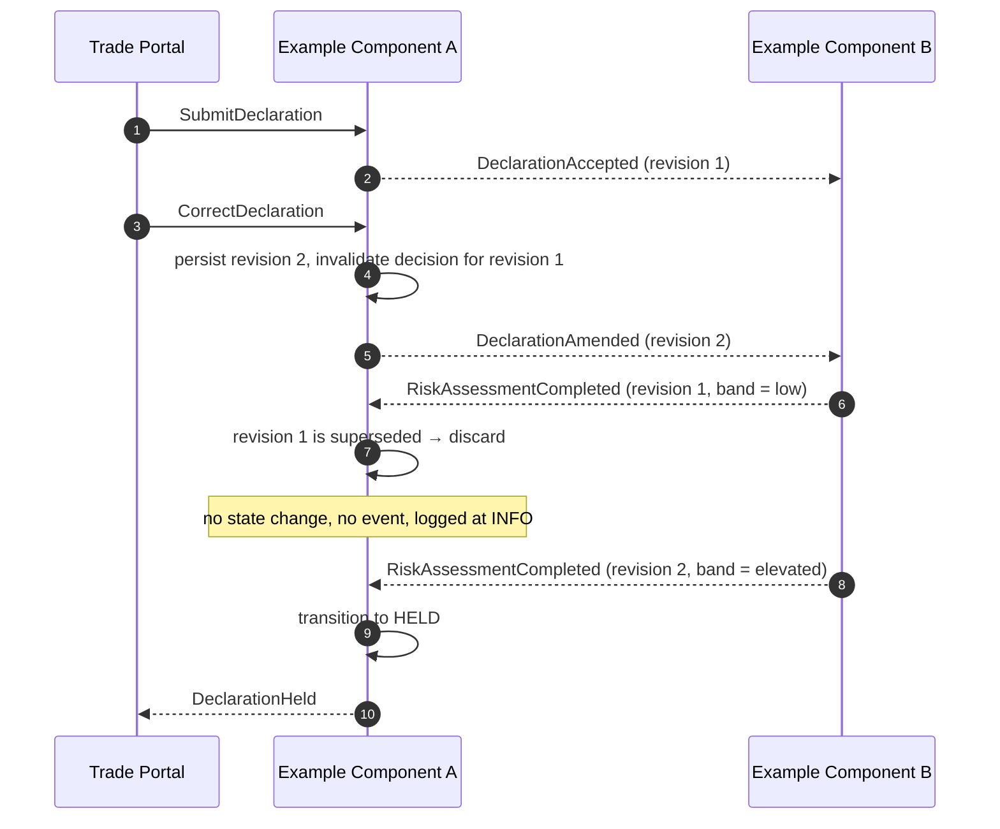

# Correction Race Scenario

<DocHeader
  system="example-system-a"
  component="example-component-a"
  section="runtime-view"
  custom={{
    owner: 'Team Alpha — Declaration Squad (fictional)',
    lastReviewed: '2026-07-30',
    reviewStatus: 'Reviewed',
  }}
/>

:::note[Custom runtime scenario]

A designed scenario, not a derived one. The generator produces the
[reaction graph](/systems/example-system-a/components/example-component-a/runtime-view/) from the handlers; it cannot know
which race conditions are worth writing down.

:::

The race that every event-driven design has to answer. The rule here: **the risk decision is
bound to a revision**, and a decision for a superseded revision is discarded.

Discarding rather than queueing is deliberate: a decision on stale input is not useful later, and
keeping it would create two plausible answers for one declaration.

<RelatedDocs
  items={[
    {
      to: '/systems/example-system-a/components/example-component-a/runtime-view/',
      label: '6. Runtime View',
      note: 'The generated reaction graph.',
      status: 'generated',
    },
    {
      to: '/systems/example-system-a/components/example-component-a/crosscutting-concerns/messaging-events-and-commands/',
      label: 'Messaging Events and Commands',
      note: 'Contracts of the messages in this scenario.',
      status: 'generated',
    },
  ]}
/>
