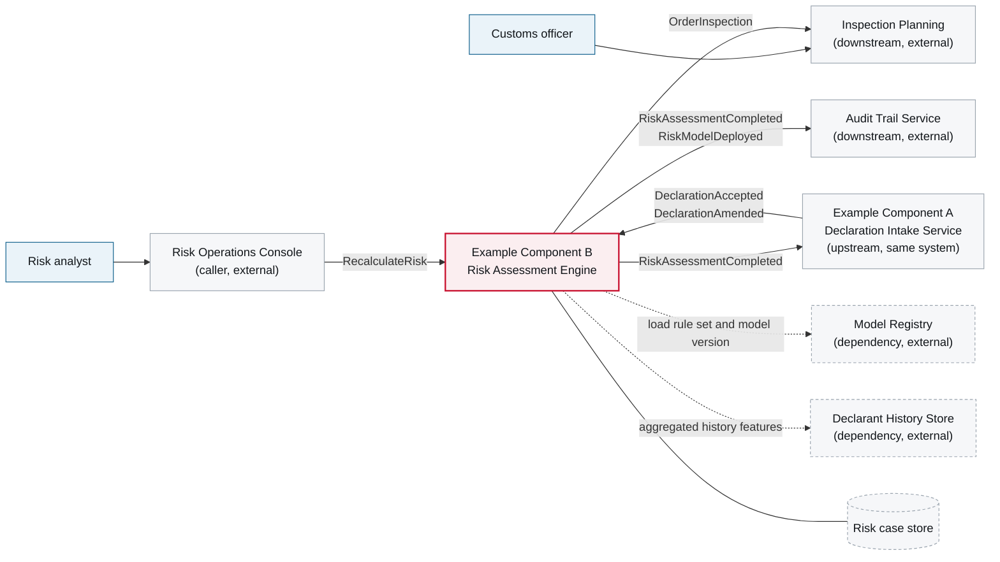

# 3. Context and Scope

<DocHeader
  system="example-system-a"
  component="example-component-b"
  section="context-and-scope"
  generated={{
    generator: 'bazg-archdoc 0.7.2',
    sourceRepo: 'git.example.admin.ch/bazg-proto/risk-assessment-engine',
    revision: '3fd8b52',
    generatedAt: '2026-08-04 03:14 UTC',
    scope: 'Whole page — context diagram and the inbound/outbound relationship tables',
  }}
/>

:::info[Fully generated page]

Derived from the component's message subscriptions, published contracts and outbound client
configurations, so it is complete by construction. Which of these relationships are load-bearing —
the part no generator can know — is written by hand in
[Scope Notes](/systems/example-system-a/components/example-component-b/context-and-scope/scope-notes/).

:::

## Generated context diagram

<Diagram
  title="Component context — Example Component B"
  status="generated"
  source="bazg-archdoc 0.7.2 · risk-assessment-engine@3fd8b52"
  caption="Solid arrows are message flows on the broker, dashed arrows are synchronous calls. Direction is from producer to consumer.">

</Diagram>

## Inbound relationships

<Diagram
  title="Inbound"
  status="generated"
  source="bazg-msgdoc 0.4.1 · risk-assessment-engine@3fd8b52">

| From | What | Transport | Contract |
| --- | --- | --- | --- |
| Example Component A | <Msg system="example-system-a" component="example-component-b" name="DeclarationAccepted" /> | Broker | `declaration/DeclarationAccepted.avsc` 2.0.0 |
| Example Component A | <Msg system="example-system-a" component="example-component-b" name="DeclarationAmended" /> | Broker | `declaration/DeclarationAmended.avsc` 1.2.0 |
| Risk Operations Console | <Msg system="example-system-a" component="example-component-b" name="RecalculateRisk" /> | Broker | `risk/RecalculateRisk.avsc` 1.0.0 |

</Diagram>

## Outbound relationships

<Diagram
  title="Outbound"
  status="generated"
  source="bazg-msgdoc 0.4.1 · risk-assessment-engine@3fd8b52">

| To | What | Transport | Contract |
| --- | --- | --- | --- |
| Example Component A, Audit | <Msg system="example-system-a" component="example-component-b" name="RiskAssessmentCompleted" /> | Broker | `risk/RiskAssessmentCompleted.avsc` 1.4.0 |
| Inspection Planning | <Msg system="example-system-a" component="example-component-b" name="OrderInspection" /> | Broker | `inspection/OrderInspection.avsc` 2.1.0 |
| Model Registry, Audit | <Msg system="example-system-a" component="example-component-b" name="RiskModelDeployed" /> | Broker | `risk/RiskModelDeployed.avsc` 1.0.0 |
| Model Registry | Rule set and model retrieval | HTTPS | `registry-api 2.0`, read-only |
| Declarant History Store | Aggregated history features | HTTPS | `history-api 1.4`, read-only |

</Diagram>

<RelatedDocs
  items={[
    {
      to: '/systems/example-system-a/components/example-component-b/context-and-scope/scope-notes/',
      label: 'Scope Notes',
      note: 'The hand-written reading of this diagram.',
      status: 'custom',
    },
    {
      to: '/systems/example-system-a/components/example-component-b/crosscutting-concerns/messaging-events-and-commands/',
      label: 'Messaging Events and Commands',
      note: 'Full contract details for every message above.',
      status: 'generated',
    },
    {
      to: '/systems/example-system-a/components/example-component-b/building-block-view/',
      label: '5. Building Block View',
      note: 'What is inside the red box.',
      status: 'generated',
    },
    {
      to: '/systems/example-system-a/context-and-scope/',
      label: 'Example System A — 3. Context and Scope',
      note: 'The same view one level up.',
      status: 'generated',
    },
  ]}
/>
