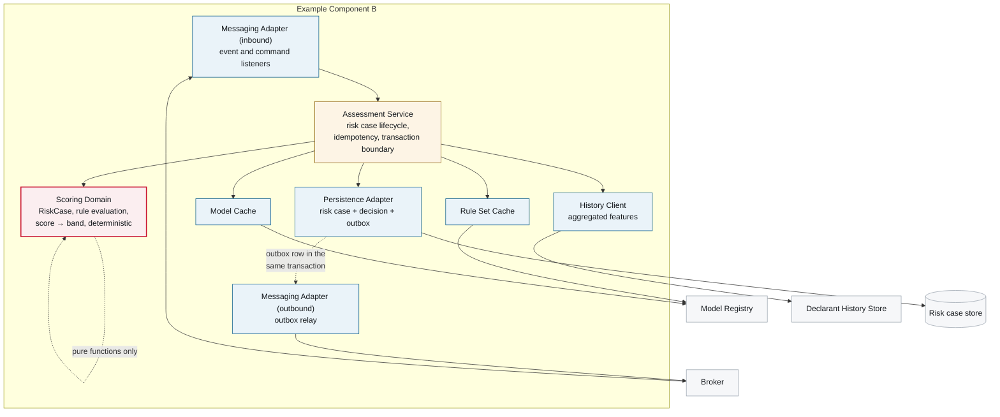

# 5. Building Block View

<DocHeader
  system="example-system-a"
  component="example-component-b"
  section="building-block-view"
  generated={{
    generator: 'bazg-archdoc 0.7.2',
    sourceRepo: 'git.example.admin.ch/bazg-proto/risk-assessment-engine',
    revision: '3fd8b52',
    generatedAt: '2026-08-04 03:14 UTC',
    scope: 'Whole page — internal component view and the building block table',
  }}
/>

:::info[Fully generated page]

Derived from the package structure and the declared ports, so it cannot drift from the code. Why
the component is shaped this way is written by hand in
[Design Notes](/systems/example-system-a/components/example-component-b/building-block-view/design-notes/).

:::

## Internal structure

<Diagram
  title="Internal component view — Example Component B"
  status="generated"
  source="bazg-archdoc 0.7.2 · risk-assessment-engine@3fd8b52"
  caption="Building blocks and their dependencies. Arrows point in the direction of the dependency.">

</Diagram>

## Building blocks

<Diagram
  title="Building blocks and responsibilities"
  status="generated"
  source="bazg-archdoc 0.7.2 · risk-assessment-engine@3fd8b52">

| Building block | Responsibility | Depends on | Notes |
| --- | --- | --- | --- |
| **Messaging Adapter (inbound)** | Deserialises events and commands, rejects unknown versions. | Assessment Service | No business logic. |
| **Assessment Service** | Opens and closes risk cases, enforces one decision per revision, owns the transaction. | Scoring Domain, caches, History Client, Persistence Adapter | Idempotency via the processed-message table. |
| **Scoring Domain** | Rule evaluation, feature assembly, score, band. Pure functions, no clock, no I/O. | — | Determinism is enforced by an architecture test that forbids clock and random access. |
| **Rule Set Cache** | Holds published rule set versions; refreshes on `RiskModelDeployed` and on a timer. | Model Registry | A version, once loaded, is never mutated. |
| **Model Cache** | Holds scoring model versions. | Model Registry | Falls back to the deterministic fallback rule set if a model cannot be loaded. |
| **History Client** | Aggregated declarant history features. | Declarant History Store | Feature-level only — never identity attributes (constraint CB-2). |
| **Persistence Adapter** | Risk case, decision and outbox tables. | Risk case store | Decisions are append-only. |
| **Messaging Adapter (outbound)** | Outbox relay. | Broker | Same pattern as Example Component A. |

</Diagram>

## Messages this component handles

The contracts themselves belong to the system — several components share them — so each one has
its own page under
[Example System A — 5. Building Block View](/systems/example-system-a/building-block-view/). What is
specific to this component is *which* of them it consumes and publishes:

<ComponentMessages system="example-system-a" component="example-component-b" />

## Messaging and runtime behaviour

The messages these blocks exchange are catalogued in
[Events and Commands](/systems/example-system-a/building-block-view/),
and their behaviour over time is in
[6. Runtime View](/systems/example-system-a/components/example-component-b/runtime-view/).

<RelatedDocs
  items={[
    {
      to: '/systems/example-system-a/components/example-component-b/building-block-view/design-notes/',
      label: 'Design Notes',
      note: 'Why the component is shaped this way.',
      status: 'custom',
    },
    {
      to: '/systems/example-system-a/building-block-view/',
      label: 'Events and Commands',
      note: 'The contracts these blocks produce and consume.',
      status: 'generated',
    },
    {
      to: '/systems/example-system-a/components/example-component-b/runtime-view/',
      label: '6. Runtime View',
      note: 'These blocks in motion.',
      status: 'generated',
    },
    {
      to: '/systems/example-system-a/building-block-view/',
      label: 'Example System A — 5. Building Block View',
      note: 'This component in its system context.',
      status: 'generated',
    },
  ]}
/>
