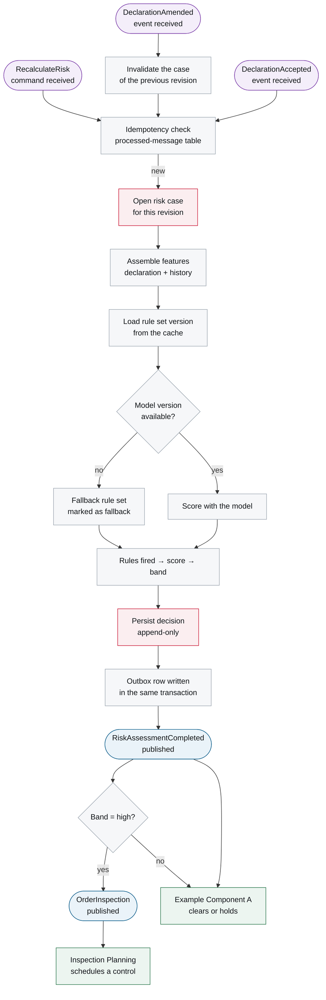
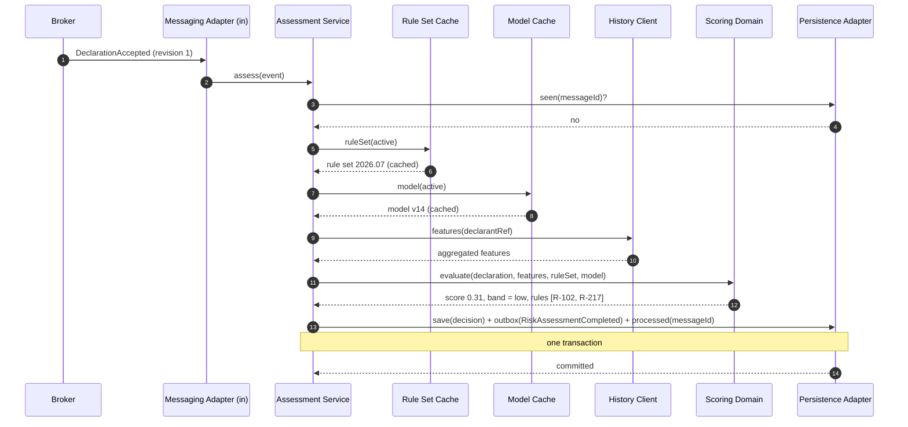

# 6. Runtime View

<DocHeader
  system="example-system-a"
  component="example-component-b"
  section="runtime-view"
  generated={{
    generator: 'bazg-archdoc 0.7.2',
    sourceRepo: 'git.example.admin.ch/bazg-proto/risk-assessment-engine',
    revision: '3fd8b52',
    generatedAt: '2026-08-04 03:14 UTC',
    scope: 'Whole page — reaction graph, reaction table and the derived sequence',
  }}
/>

:::info[Fully generated page]

Derived from the component's message handlers: which message triggers which use case, what it
changes and what it publishes. The scenarios that had to be *designed* rather than derived are
hand-written pages below this section.

:::

## Generated reaction graph

<Diagram
  title="Reaction graph — event to decision"
  status="generated"
  source="bazg-archdoc 0.7.2 · risk-assessment-engine@3fd8b52"
  caption="Rounded nodes are messages; rectangles are processing steps. Every path ends in a published decision — the component never stays silent.">

</Diagram>

### Reactions in table form

<Diagram
  title="Message reactions"
  status="generated"
  source="bazg-archdoc 0.7.2 · risk-assessment-engine@3fd8b52"
  caption="Each row is one message handler. Follow a message name to its contract in the messaging catalogue.">

| Trigger | Use case | State change | Publishes |
| --- | --- | --- | --- |
| <Msg system="example-system-a" component="example-component-b" name="DeclarationAccepted" /> | Assess revision | New risk case, one decision | <Msg system="example-system-a" component="example-component-b" name="RiskAssessmentCompleted" />, on `high` also <Msg system="example-system-a" component="example-component-b" name="OrderInspection" /> |
| <Msg system="example-system-a" component="example-component-b" name="DeclarationAmended" /> | Re-assess after correction | Previous case invalidated, new case | <Msg system="example-system-a" component="example-component-b" name="RiskAssessmentCompleted" /> |
| <Msg system="example-system-a" component="example-component-b" name="RecalculateRisk" /> | Manual re-assessment | New decision on the same revision, new decision id | <Msg system="example-system-a" component="example-component-b" name="RiskAssessmentCompleted" /> |
| Rule set / model activation | Publish version | Caches refreshed | <Msg system="example-system-a" component="example-component-b" name="RiskModelDeployed" /> |

</Diagram>

## Scenario — assessment with the internal building blocks

## Rolling out a new rule set

The operational scenario for publishing rules and models is a separate custom page:
[Rule Set Rollout](/systems/example-system-a/components/example-component-b/runtime-view/rule-set-rollout/).

<RelatedDocs
  items={[
    {to: '/systems/example-system-a/components/example-component-b/runtime-view/rule-set-rollout/', label: 'Rule Set Rollout', note: 'Custom operational scenario below this arc42 section.', status: 'custom'},
    {to: '/systems/example-system-a/components/example-component-b/crosscutting-concerns/messaging-events-and-commands/', label: 'Messaging Events and Commands', note: 'Contracts for every message above.', status: 'generated'},
    {to: '/systems/example-system-a/components/example-component-a/runtime-view/', label: 'Example Component A — 6. Runtime View', note: 'The other half of the conversation.', status: 'generated'},
    {to: '/systems/example-system-a/runtime-view/', label: 'Example System A — 6. Runtime View', note: 'The same flows at system level.', status: 'custom'},
  ]}
/>
