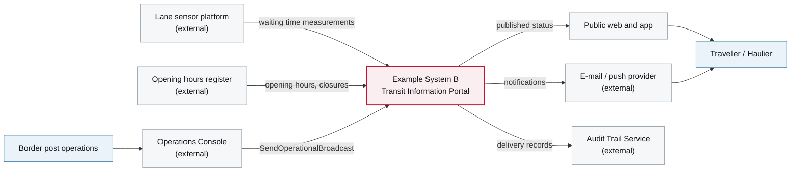

# 3. Context and Scope

<DocHeader system="example-system-b" section="context-and-scope" status="mixed"
  generated={{
    generator: 'bazg-archdoc 0.7.2',
    sourceRepo: 'git.example.admin.ch/bazg-proto/example-system-b',
    revision: '7b20ae1',
    generatedAt: '2026-08-03 03:09 UTC',
    scope: 'Context diagram',
  }}
  custom={{owner: 'Team Beta — Public Information Services (fictional)', lastReviewed: '2026-07-11'}} />

The system reads from measurement and operational sources and writes to public channels. It has
no inbound business interface — nobody submits anything to it.

<Diagram
  title="System context — Example System B"
  status="generated"
  source="bazg-archdoc 0.7.2 · example-system-b@7b20ae1"
  caption="Sources on the left, channels on the right. The system only ever republishes.">

</Diagram>

## Outside the boundary

Waiting times are measured elsewhere; this system never computes them. Declaration and clearance
data belong to [Example System A](/systems/example-system-a/) and are not accessible from here.

<RelatedDocs items={[
  {to: '/systems/example-system-b/building-block-view/', label: '5. Building Block View', status: 'mixed'},
  {to: '/systems/example-system-b/components/example-component-c/context-and-scope/', label: 'Example Component C — 3. Context and Scope', status: 'mixed'},
]} />
