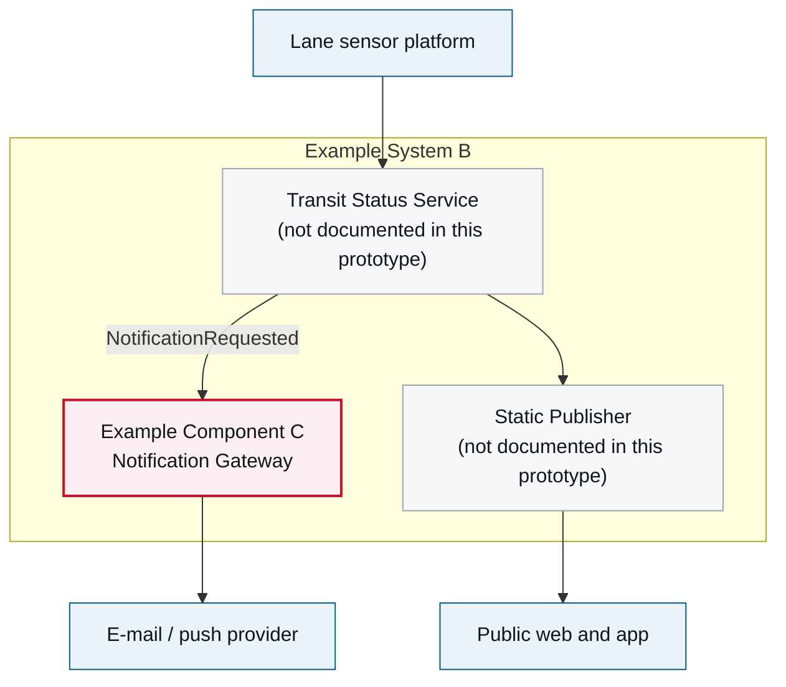

# 5. Building Block View

<DocHeader system="example-system-b" section="building-block-view" status="mixed"
  generated={{
    generator: 'bazg-archdoc 0.7.2',
    sourceRepo: 'git.example.admin.ch/bazg-proto/example-system-b',
    revision: '7b20ae1',
    generatedAt: '2026-08-03 03:09 UTC',
    scope: 'Component diagram and component table',
  }}
  custom={{owner: 'Team Beta — Public Information Services (fictional)', lastReviewed: '2026-07-11'}} />

<Diagram
  title="Component diagram — Example System B"
  status="generated"
  source="bazg-archdoc 0.7.2 · example-system-b@7b20ae1"
  caption="Only the notification gateway is documented as a component in this prototype; the other blocks are named for context.">

</Diagram>

## Contained components

<CardGrid>
  <ComponentCard system="example-system-b" component="example-component-c" />
</CardGrid>

| Building block | Responsibility | Documentation |
| --- | --- | --- |
| Transit Status Service | Ingests measurements, decides what is current, requests notifications. | Not documented in this prototype |
| Static Publisher | Renders and invalidates the public pages. | Not documented in this prototype |
| [Example Component C](/systems/example-system-b/components/example-component-c/) | Fans notifications out to all channels and records delivery. | <StatusBadge status="mixed" small /> |

<RelatedDocs items={[
  {to: '/systems/example-system-b/components/example-component-c/', label: 'Example Component C', status: 'mixed'},
  {to: '/systems/example-system-b/runtime-view/', label: '6. Runtime View', status: 'custom'},
]} />
