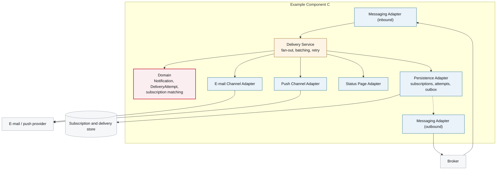

# 5. Building Block View

<DocHeader system="example-system-b" component="example-component-c" section="building-block-view"
  generated={{
    generator: 'bazg-archdoc 0.7.2',
    sourceRepo: 'git.example.admin.ch/bazg-proto/notification-gateway',
    revision: 'd52c118',
    generatedAt: '2026-08-03 03:10 UTC',
    scope: 'Internal component view and building block table',
  }}
/>

<Diagram
  title="Internal component view — Example Component C"
  status="generated"
  source="bazg-archdoc 0.7.2 · notification-gateway@d52c118">

</Diagram>

| Building block | Responsibility |
| --- | --- |
| **Messaging Adapter (inbound)** | Deserialises the notification request and the broadcast command. |
| **Delivery Service** | Matches subscriptions, batches within the rate limit, drives retries. |
| **Domain** | `Notification`, `DeliveryAttempt`, subscription matching rules. |
| **Channel adapters** | One per channel, behind a single port. Adding a channel adds an adapter and nothing else. |
| **Persistence Adapter** | Subscriptions, delivery attempts, outbox. |
| **Messaging Adapter (outbound)** | Publishes delivery and failure events from the outbox. |

<RelatedDocs items={[
  {to: '/systems/example-system-b/components/example-component-c/crosscutting-concerns/messaging-events-and-commands/', label: 'Messaging Events and Commands', status: 'generated'},
  {to: '/systems/example-system-b/components/example-component-c/runtime-view/', label: '6. Runtime View', status: 'generated'},
]} />
