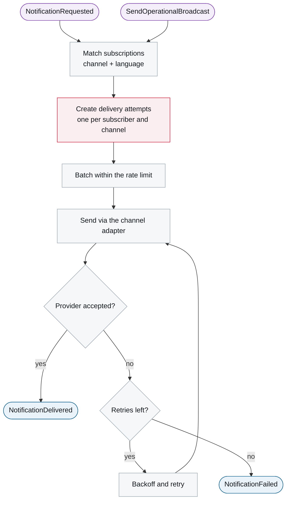
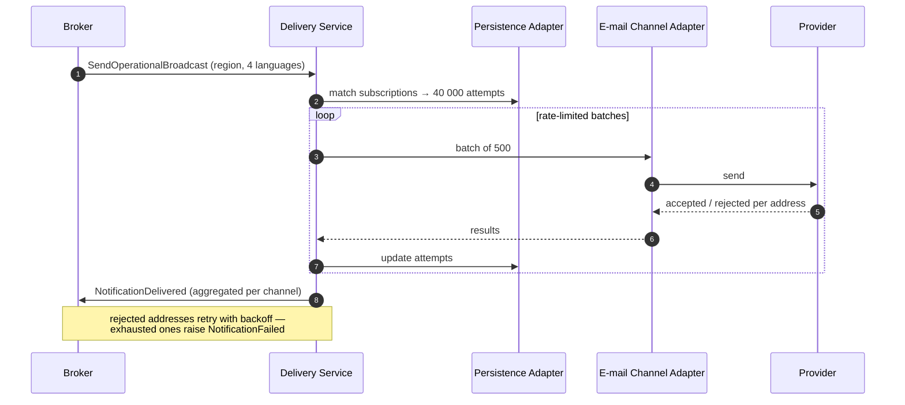

# 6. Runtime View

<DocHeader system="example-system-b" component="example-component-c" section="runtime-view"
  generated={{
    generator: 'bazg-archdoc 0.7.2',
    sourceRepo: 'git.example.admin.ch/bazg-proto/notification-gateway',
    revision: 'd52c118',
    generatedAt: '2026-08-03 03:10 UTC',
    scope: 'Reaction graph',
  }}
/>

## Generated reaction graph

<Diagram
  title="Reaction graph — request to delivery record"
  status="generated"
  source="bazg-archdoc 0.7.2 · notification-gateway@d52c118"
  caption="Rounded nodes are messages; rectangles are processing steps.">

</Diagram>

| Trigger | Use case | Publishes |
| --- | --- | --- |
| <Msg system="example-system-b" name="NotificationRequested" /> | Deliver to matching subscriptions | <Msg system="example-system-b" name="NotificationDelivered" /> or <Msg system="example-system-b" name="NotificationFailed" /> |
| <Msg system="example-system-b" name="SendOperationalBroadcast" /> | Deliver to all subscriptions of the affected region | same |

## Scenario — a closure broadcast to 40 000 subscribers

<RelatedDocs items={[
  {to: '/systems/example-system-b/building-block-view/', label: 'Events and Commands', status: 'generated'},
  {to: '/systems/example-system-b/runtime-view/', label: 'Example System B — 6. Runtime View', status: 'custom'},
]} />
